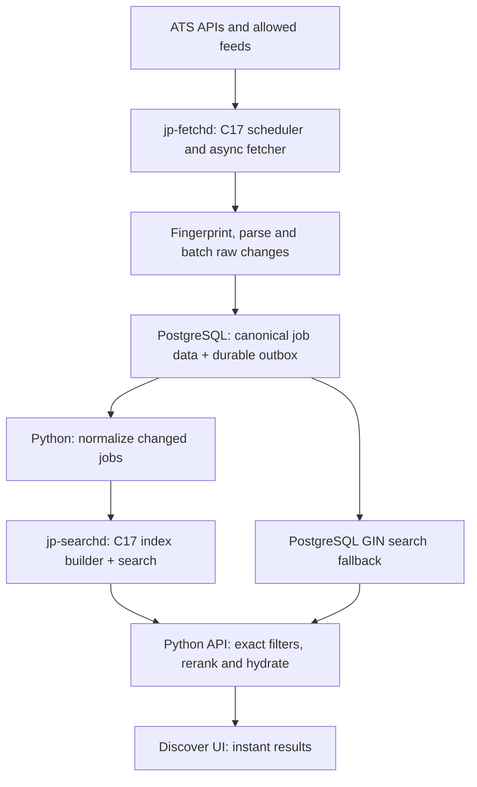

# JobPilot Search Engine (JPSE)

## Ultimate engineering blueprint: C17, sub-second discovery, million-job indexing

**Date:** 17 November 2026  
**Status:** Design for implementation; not a claim that the engine already exists  
**Primary constraint:** Integrate with the existing Python backend, PostgreSQL, `scoring_v2`, salary/location normalization, job-discovery UI, and source-access policies  
**Core decision:** Use C17 for the native crawler and search acceleration engine, while PostgreSQL remains the authoritative database. Do not introduce an AI model.

---

## 1. Executive decision

Build **one native C codebase with two independently deployable processes**:

1. **`jp-fetchd`** — polite, high-concurrency background crawler, parser, change detector and batch writer.
2. **`jp-searchd`** — low-latency search server using an on-disk, memory-mapped inverted index, hot hash tables, compressed filter bitmaps and a native query planner.

They communicate through committed PostgreSQL data and a durable change queue, **not through fragile in-memory messages**. The existing Python application provides normalization, user-specific scoring, saved searches, auth and API endpoints. Search works while crawling is paused. A crawler bug must not interrupt search.

The non-negotiable first change is to **crawl once for everyone and search the locally indexed catalogue**. A native C rewrite alone cannot turn a network-bound seven-minute crawl into a millisecond operation.

### Evidence from the supplied JobPilot owner document

| Observed measurement | Implication |
|---|---|
| Run 73 ~7.5 min; 206 boards; ~26,137 listings; 62 matches, 0 new | Discovery currently waits for substantial repeated network work |
| Feeds ~10 s; boards ~6 min 20 s | The board-fetching architecture dominates |
| Greenhouse ~86% network time; Lever ~99%; Ashby ~99.5%; SmartRecruiters ~99.7% | Faster parsing is secondary until concurrency/reuse/background operation are fixed |
| Only ~343 matched jobs currently persisted, per draft | Index **all allowed postings**, not only matches for an existing user |
| Reported host 12 cores, 10 GB RAM and ~2 GB free | Set conservative CPU/RSS limits; measure real headroom before increasing |

These numbers are from the attached document, not an independent measurement of the live repository or production server. Validate them again before setting quotas.

## 2. Service-level objectives and honest scope

Measure these **under representative load** with a fixed 1-million-job corpus and at least 20 simultaneous search clients. A target is accepted only after measurement on the deployment hardware; cold-cache and broad queries are measured separately.

| Measurement | Initial target | How to measure |
|---|---:|---|
| Search-only C engine, warm, ordinary filtered queries | p50 ≤ 3 ms, p95 ≤ 7 ms, p99 ≤ 15 ms | Socket request through completed C candidate search |
| End-to-end Discover API, no crawl attached | p95 ≤ 300 ms, p99 ≤ 800 ms | HTTP request incl. Python ranking, DB hydration and serialization |
| UI first useful results | ≤ 1 s | Browser RUM, network and rendering included |
| Search index propagation after normalization commit | p95 ≤ 2 s, p99 ≤ 10 s | Commit timestamp → searchable version |
| Full 206-board refresh | ≤ 90 s, *if source policies and response times permit* | Crawler benchmark, never override external rate limits |
| Unchanged 206-board refresh | Aim ≤ 30 s, conditional responses where supported | Network + scheduler + DB work; not guaranteed by ETags |
| Query candidate recall vs exhaustive JobPilot scoring | ≥ 99% at candidate limit 1000 on evaluation set | Offline judgment set and current scorer |
| Unauthorized / blocked sources | Zero requests | Recorded network and policy audit |
| Missing jobs accidentally marked closed after failed/partial crawl | Zero | Integration tests and production audits |

Distinguish **search latency** from **crawl freshness**. A five-millisecond query does not mean the website has published a job within five milliseconds of its original posting. Freshness depends on source rate policies and adaptive recrawl intervals.

### Quality bars that are as important as speed

- Exact country, remote eligibility, employment, salary and work-authorization constraints must never be bypassed by fuzzy search.
- No invented salary conversions; retain the existing currency semantics.
- No aggressive deduplication that hides genuinely distinct requisitions.
- No more privileged source access than the existing permitted ATS/API access.
- Feature-flagged rollback to PostgreSQL search on engine failure.

## 3. Final architecture



The diagram omits the background alert worker: it consumes job-change events, identifies relevant saved searches and calls the existing scoring/notification logic.

**Why two C processes?** A parsing crash, slow target, merge operation or huge response cannot take down the native search server. They can have different quotas and deployment schedules. They still share a C library for hashing, serialization, memory allocation, metrics and tests.

## 4. Workload-first indexing strategy

Treat each source posting as one stable **requisition identity**:

`source_namespace + board_id + source_job_id`

Use a fallback canonical URL identity only when a source provides no durable ID. Store a source-specific version/revision. Every job also has a stable PostgreSQL ID; within each sealed segment the engine uses a dense **32-bit segment-local document ID**. Avoid changing the global canonical ID during compaction.

### Canonical store and data model

Proposed additive tables (adapt actual names/types to the existing schema):

| Table | Essential fields | Purpose |
|---|---|---|
| `crawl_targets` | target id, URL, ATS kind, host, enabled, source policy | Stable inventory |
| `crawl_state` | target, ETag, Last-Modified, body fingerprint, next due, failures, last complete snapshot | Resumable frontier |
| `raw_job_postings` | stable source key, raw fields or raw payload reference, body revision, source board, observed at | Lossless source import |
| `jobs` | canonical job id, source identity, normalized fields, raw/revision hashes, open/closed, updated at | Searchable authority |
| `job_source_membership` | board + source job id, last successful complete snapshot | Accurate closed detection |
| `index_outbox` | event id, job id, revision, event type, state/attempts, created at | Durable synchronization |
| `search_taxonomy_versions` | version, checksum, effective time | Reproducible synonyms and normalization |
| `index_metadata` | generation, schema version, checkpoint, corpus count, checksum | Recovery and operations |

Existing `jobs` and user-job tables remain in place. This should be an additive migration, never a destructive rewrite.

### Correct ingestion transaction order

1. Crawler fetches and parses a complete board response.
2. Bulk-load rows into a transaction-scoped staging table using `libpq` `COPY`.
3. Upsert *only changed* source postings and record source membership.
4. Commit the raw import and durable outbox events in the same transaction.
5. Python normalization worker consumes raw-change events, updates canonical jobs using existing `core/locations.py` and `core/salary.py`, and commits **index-ready outbox events** atomically with those changes.
6. C search indexer applies each new revision idempotently, makes it durable, then acknowledges the queue item.

`LISTEN/NOTIFY` may wake consumers, but is **never the only delivery mechanism**. A durable queue must survive disconnected listeners, crashes and restarts. Use `FOR UPDATE SKIP LOCKED`/leases for workers where appropriate. Do **not** simply advance a `BIGSERIAL` high-water mark: transactions can commit out of allocation order. If the system later uses logical decoding, use commit-ordered changes and an LSN checkpoint instead.

### Closed-job correctness

Only close vanished source IDs **after a successful, complete, semantically valid board snapshot**. Never close on timeout, rate limit, partial page, malformed response, empty error page or missing pagination. Treat a board returning an unexpectedly empty list as suspicious until confirmed; log and quarantine before mass closure. Preserve a separate source revision history for audit.

## 5. Native C crawler: `jp-fetchd`

### I/O subsystem

- **C17 + libcurl multi socket API** (or libcurl multi poll) with one event loop and reusable easy handles. Use HTTP/2 multiplexing when servers negotiate it; don't assume every ATS uses HTTP/2.
- Connection caching is already shared by easy handles attached to one libcurl multi handle; don't build a redundant per-host connection manager unless benchmarks require it.
- DNS resolution must be non-blocking. Check the compiled libcurl backend; use c-ares only if necessary, rather than adding it by default.
- Bounded queues from download → parse → write, with backpressure when parsing/DB is behind.
- Start with **16 total concurrent transfers**, **2 per host** and measured per-host token buckets. Raise global concurrency toward 32 only if host policy, RAM, network and error logs allow. The limits are policy, not a speed knob to turn up blindly.
- Use bounded responses, compressed transfer accounting, max redirects, DNS/connect/read/overall timeouts, jittered retries and retry budgets.
- Support `If-None-Match`/`If-Modified-Since` **only for endpoints that behave correctly**. Measure ATS-specific support; 304 responses cannot be assumed.
- Use a fast hash to skip equal bodies even if no ETag is available, but keep periodic complete reconciliations.

### Source access and SSRF

- Enforce an allowlist of ATS API hosts and explicitly approved feeds; enforce the existing LinkedIn/Naukri/Indeed/Glassdoor denial inside fetch code.
- Robots/terms/source rules are applied even during catch-up, replays and user-triggered priority refreshes.
- Restrict URL protocols to HTTPS/HTTP as appropriate; block local/private/link-local/metadata endpoints, IP literals where forbidden, DNS rebinding and unsafe redirects. Validate the actual connection IP and every redirect, not just the initial hostname.
- Disable untrusted proxy environment behavior; never forward credentials across origin redirects.
- Maintain an identifiable user agent and a per-host circuit breaker. Do not evade source rate limits or access restrictions.

### Scheduler

**Durable priority queue** keyed by `next_due_at`, `watch_priority` and overdue time. A min-heap in C is a working cache of the database frontier, not the sole durable record.

Start with **15 min min**, **1 h default**, **12 h max** between fetches. Reduce interval when a board reliably changes; increase by a capped multiplier on repeated unchanged snapshots. Watch priority can cap the interval at 1 h if source policy permits. Preserve retry/backoff intervals independently, so a watched board cannot override 429 cooling-off.

Track not only changed/not-changed but **change probability per unit cost**: an active, low-latency source earns more slots than a consistently idle, expensive board. However, enforce a maximum stale age to prevent starvation.

### Parser

Use `yyjson` first for the permitted ATS JSON formats; benchmark it with recorded payloads against alternatives. Explicit extractors are required for Greenhouse, Lever, Ashby, SmartRecruiters, Recruitee and permitted feeds. HTML/JSON-LD is a later isolated source adapter, not a prerequisite for the fast ATS engine.

Strictly bound input length, nesting depth, counts, UTF-8 processing and allocation. Parse into source-typed structures and hand raw job content to Python normalization only when source fields changed. Unknown fields may be archived without becoming runtime schema dependencies.

### Change and deduplication

- Full body: fast `XXH3-128` change fingerprint, **not** job identity.
- Posting: normalized meaningful-field fingerprint; include title, company, location, salary, description, source status and canonical URL.
- Primary identity: stable ATS requisition ID, never `(company,title,location)` alone.
- Cross-source duplicate: soft equivalence group, with provenance and confidence; retain every original requisition ID.
- SimHash near-duplicate detection: suggest grouping, **never automatically erase** distinct vacancies based on Hamming distance alone.

## 6. Search server: `jp-searchd`

### Data layout

Use a memory-mapped **segment index**:

```text
index-v1/
  manifest              # versioned generation and checksums
  segment-00001/
    meta                 # segment header, doc count, limits
    terms                # sorted dictionary / optional MPH
    postings             # delta-encoded document IDs and TFs
    blockmax             # safe upper score bounds
    filters              # Roaring bitmaps per categorical value
    columns              # dense numeric/date columns
    docmap               # local doc ID -> stable job ID + revision
    live                  # deletion bitmap / generation metadata
```

- **One hot, mutable segment** accumulates changes; one thread publishes updates.
- **Immutable sealed segments** are mmap-backed and checksummed. Seal based on either 10k changed docs, target size or time; tune from measurements, not fixed dogma.
- Background compaction merges small segments, removes obsolete revisions and updates corpus term statistics.
- Readers take a reference-counted generation snapshot and execute without holding writer locks. Reclaim old mapped generations only after existing readers exit.
- Persist manifest and new segment files with atomic rename plus `fsync` discipline; verify checksums at open.
- Keep the canonical PostgreSQL job row as the authoritative source of full description and UI metadata.

### Data structures: which ones belong where

| Workload | Default | Reason / decision gate |
|---|---|---|
| Dynamic term dictionary, source ID map | **Swiss-inspired open-addressing hash map** in C with SIMD fingerprint probing; benchmark scalar fallback | Good cache locality; needs exact key equality and safe deletion/resize |
| Tiny enumerations (job types, modes) | Dense `uint8_t` IDs or sorted small arrays | Avoid hash overhead entirely |
| Segment-local categorical filters | **CRoaring** | Fast AND/OR and compact sparse or dense containers |
| Text term → ordered postings | **Inverted lists**, not hash map of every document | Efficient retrieval without scanning all jobs |
| Postings compression | Delta + SIMD-BP128 or StreamVByte, chosen by bench | Fast decode and compact storage |
| Numeric salary/date constraints | Columnar numeric arrays + bucket prefilter | Exact comparison after reducing candidate set |
| Hot document metadata | Dense arrays indexed by doc ID | One cache-friendly access; no hash lookup |
| Prefix suggestions | Sorted term dictionary; add FST if needed | Avoid building complex typo machinery until measured |
| Sealed term dictionary | Sorted string table first; optionally minimal perfect hash | MPHF helps only if lookup gains repay build time and extra exact-key verification |
| Per-query temporary candidate set | Small vector / heap / arena | Avoid process-wide hash tables and per-hit `malloc` |

**Do not implement five different hash maps, HLL selectors, cuckoo filters and incremental resize in the first milestone.** Those components add many failure modes and often don't improve end-to-end latency. The hash table is a *dictionary*; the inverted index and bitmap intersections do the heavy search work.

For a true **pure-C** engine, Abseil and PTHash are not drop-in C libraries: they are C++. Use their research as design inspiration, or explicitly approve a narrow C ABI wrapper if benchmark evidence justifies one. Keep a `khash`-class conventional C baseline for all hash-map comparisons.

Hashing: random-seeded fast non-cryptographic hash for ordinary internal table keys, exact key comparison after fingerprint match, and a keyed collision-resistant option for attacker-controlled keys if hash flooding is a risk. A 64-bit or 128-bit hash by itself is **not** a unique database identity.

### Query execution — prioritize filters and recall

1. Compile filters using the **same normalized semantics** as current Python business rules (location eligibility, remote availability, mode, seniority, active state, visa sponsorship, salary currency/range).
2. Pin an index-generation snapshot and intersect the most selective filter bitmaps first; use estimates or measured cardinalities.
3. Normalize query terms with a **versioned skill/title taxonomy** (e.g., "O2C" and "order to cash"); cap synonym expansions.
4. For highly selective filters, exhaustively score the reduced candidate set with a vectorized term lookup. For broad lexical queries, use block-max WAND or MaxScore to avoid irrelevant scoring.
5. Compute a cheap native BM25F-like lexical score plus **bounded, correctly upper-bounded** freshness/title bonuses. Early termination is correct only when pruning bounds include every score term used at that stage.
6. Gather a variable candidate pool (start 500; allow 1000 or more on broad/diverse queries). Return stable job IDs, coarse scores and hit explanations.
7. Python hydrates the candidate jobs in one DB batch and reranks using existing `scoring_v2`, applies any remaining exact eligibility rules and produces the final 50.
8. Group soft duplicates *after* preserving all underlying requisitions, so users can inspect separate jobs.

**Critical search-quality warning:** If Python's scoring can favor a job with weak lexical overlap, native BM25 top-200 can permanently hide that job. Evaluate `Recall@500`, `Recall@1000` and `nDCG@10` against exhaustive Python scoring, per query class. No top-k latency number is accepted if it fails the quality gate.

### Modes

- **Filter-only / latest:** use date-sorted recent-doc shortlist with bitmap membership; avoid a full `FILTER` scan for huge broad queries.
- **Exact lexical:** inverted lists and term matching.
- **Hybrid terms + filters:** select between filter-first and block-max pruning based on estimated candidate count.
- **Autocomplete:** separate tiny prefix query with a 50–100 ms debounce in the UI, max 10 suggestions.
- **Alerts:** changed job → reverse saved-search candidate lookup; first implement in Python using Postgres indexed search definitions, move to C only when volume warrants it.

No semantic embeddings, vector database, GPU or generative model are required for this engine.

## 7. Durable sync, crash recovery and data integrity

This deserves as much engineering attention as the inverted index.

### Replay protocol

- Each job update carries `job_id` and a monotonic **per-job version**. A stale event never replaces a newer indexed revision.
- Queue processing is at least once; apply operations idempotently.
- Acknowledge an event **only after the index journal/manifest checkpoint is durable**; otherwise recovery must replay it.
- On startup, verify the segment manifest and checksums, replay durable unacknowledged events, reconcile against committed Postgres versions, and expose `ready=false` until searchable.
- Rebuilding from scratch must be possible using a consistent database snapshot, followed by changes committed after that snapshot. Prefer an explicit snapshot/CDC handoff, or a safe reconciliation protocol; don't use only `updated_at > seal_time`.
- Keep at least one previous valid manifest generation so interrupted compaction does not corrupt the index.
- On schema or taxonomy change, build a new index generation alongside the old one, validate, then swap atomically.

### Failure cases to test

Crash at every point between `COPY`, canonical job update, outbox insertion, index journal fsync, segment seal, manifest rename and queue acknowledgment; duplicate events; out-of-order revisions; source deletion then reappearance; corrupt/truncated segment; unsupported source changes; disk full; 429 storm; network loss; PostgreSQL restart.

## 8. Search API and integration

Expose a **versioned Unix domain socket** protocol from C:

| Method | Request | Response |
|---|---|---|
| `search` | query terms, compiled filters, candidate limit, query deadline, taxonomy version | ranked candidate IDs, coarse score, matched fields, generation |
| `suggest` | prefix, language, limit | suggestions |
| `stats` | none | counts, queue lag, segment count, RSS, latency buckets |
| `health` | none | ready, generation, last event, fallback flag |
| `refresh` | validated target IDs, priority | accepted target IDs and state (handled by crawler service) |

Set a magic/version header, maximum frame size, timeouts, peer credential permissions, strict length checks and schema validation. JSON is fine for debug; a bounded binary wire format such as MessagePack is preferred when benchmarks show JSON overhead. Do not build zero-copy shared memory until profiling proves IPC is material.

Python client behavior:

- Feature flag `JPSE_SEARCH_ENABLED` initially false.
- Fail fast with a deadline; fallback to indexed PostgreSQL GIN search without triggering a crawl.
- Bulk-fetch candidate jobs using one query and preserve native rank order.
- Log divergence in shadow mode, then ramp traffic 1% → 10% → 50% → 100%, with automated rollback alarms.
- Cache normalized query+filters+generation+taxonomy+scoring-version keys for a short TTL only if it actually improves p95 under real traffic. Never cache user authorization assumptions under a shared key.

## 9. Baseline alternatives: test before inventing algorithms

The native index should beat realistic competitors, not just an unindexed SQL query.

1. **PostgreSQL GIN full-text index** + ordinary SQL filters. This is the operational fallback and the first performance baseline.
2. **SQLite FTS5**, called from C, with weighted BM25 and optional external-content storage, as a C-native *reference implementation*. A local FTS5 prototype may be fast enough to ship an intermediate version.
3. **Custom C segment engine** with inverted lists, CRoaring and adaptive Block-Max WAND/MaxScore. Keep it only if it improves relevant p99/throughput/RSS without sacrificing query quality.

Run them with identical 26k, 100k and 1m-job datasets and the same hardware quotas. Published papers on larger web corpora are useful design evidence, **not** transferable JobPilot latency guarantees.

## 10. Low-level performance engineering

### Compiler and CPU

- C17, Clang and GCC release builds; profile-guided optimization (PGO) after collecting real queries; LTO if it measurably helps.
- Runtime CPU feature dispatch for SIMD functions (SSE2/AVX2/AVX-512 where present), plus correct scalar fallback. AVX-512 is not automatically faster on every CPU.
- Structure-of-arrays for hot scoring metadata; minimize pointer chasing, branch misprediction and LLC misses.
- Arena allocation per query/segment; no per-posting heap churn; bounded ring buffers with backpressure.
- Thread pools sized to measured CPU quotas. Give search threads priority over compaction and parsing.
- Use performance counters (`perf`) to identify cache misses, cycles, branch misses and memory bandwidth before tuning.

### Memory allocation and quotas

Do not rely on a fixed "1.5 KB per posting" promise: index size varies with description lengths, number of unique terms, field cardinality, tombstones and segment overhead.

With the **reported ~2 GB currently free** on the host, begin cautiously: roughly **512 MB RSS target for `jp-searchd`**, **256 MB for `jp-fetchd`**, with explicit disk/index capacity and a measurement-based increase procedure. If the live host cannot spare that, deploy on a separate worker node. mmap trades heap consumption for filesystem-backed pages; it does **not** guarantee a small resident set or eliminate disk I/O.

Segment compaction must obey a memory budget and yield to search; do not double the entire index in memory during merges.

## 11. Security requirements for native code parsing internet input

- Fetcher and indexer run as non-root, no extra Linux capabilities, read-only root filesystem, restricted writable volume, restrained egress and source policy.
- Fuzz each parser, protocol decoder and index loader with AFL++ or libFuzzer; keep a regression corpus of real ATS payloads.
- ASan and UBSan for normal CI. MSan is a separate specialized build when its instrumented dependencies are practical; it is **not** assumed to run in every build.
- Use bounded length-delimited string views. No unchecked buffer copies, unbounded recursion or integer-overflow-prone allocation multiplication.
- Add maximum payload bytes, job count, nesting depth, URL length, term length, token count and per-request CPU budget.
- Test SSRF defenses for DNS rebinding and cross-host redirects. Disable dangerous libcurl URL schemes and unsafe protocol changes.
- Separate DB roles: crawler only writes allowed ingestion tables; normalization worker updates normalized jobs; index reader consumes only required fields.
- Keep dependencies pinned, check published advisories and rebuild on fixes. Maintain an SBOM and reproducible container images.

## 12. The benchmark laboratory

### Fixed corpus

- Preserve **recorded source fixtures** from all supported ATS types, including malformed, empty, slowly paginated and partially unavailable boards.
- Build 26,137 real-like job records from existing fixtures (where permitted), plus deterministic synthetic 100k / 1m / 5m corpora preserving term frequencies, source distribution and field sizes.
- Generate a 2,000-query evaluation suite from representative saved searches: sparse/dense skill queries, no-keyword filters, remote India, salary, title synonyms, recent only, missing fields, broad query, typo/prefix suggestions.
- Establish correct outputs with the existing Python scoring logic and independently asserted exact filters.

### Four benchmarking modes

1. **Micro**: hash lookup success/failure at different load factors; SIMD bitmap AND/OR; compressed posting decode; string normalization; IPC serialization.
2. **Index**: raw import throughput, incremental update throughput, compaction time, crash/restart recovery, index disk/RSS size.
3. **Query**: p50/p95/p99 at concurrency 1, 5, 20, 50; warm and cold cache; sustained 30-minute run; RSS and CPU throttling.
4. **Crawler**: per-source HTTP breakdown, connection reuse, full vs unchanged, rate-limit errors, error backoff, source-policy compliance.

Collect `Recall@100/500/1000`, `nDCG@10`, job-eligibility false positives, and false negatives. Monitor code and data versions to make regressions reproducible.

No low-level optimization is promoted merely because its isolated microbenchmark is faster: it must improve a relevant user-visible metric without breaching resource or quality targets.

## 13. Phased delivery with hard acceptance gates

| Phase | What ships | Critical acceptance test | Illustrative effort |
|---|---|---|---|
| **0 — Instrumentation** | Stable fixtures, current run timing, query corpus, Postgres GIN baseline, resource profile | Reproducible Run-73-like benchmark and correctness oracle | 2–3 engineering days |
| **1 — Instant discovery architecture** | Background Python crawler, pooled async fetches, incremental bodies, all-source posting storage, durable change queue | Discover no longer waits on network; exact old matches retained | 1–2 weeks |
| **2 — C crawler foundation** | `jp-fetchd`, libcurl multi, policies, bounded JSON parsers, batch writes, fuzzing | Same source IDs and fields as Python on all fixtures; safe limits | 1–2 weeks |
| **3 — C search MVP** | `jp-searchd`, mutable index, sealed mmap segments, basic term postings + Roaring filters, Unix socket | p99 < 30 ms for measured query suite; no filter/identity bugs | 2–3 weeks |
| **4 — Advanced retrieval** | Compression, query planner, Block-Max WAND/MaxScore, bounded rerank candidates, suggestions | p99 search ≤ 15 ms **and** candidate recall target met | 1–2 weeks |
| **5 — Reliability and rollout** | Durable recovery, shadow mode, rollback, percolated alerts, production dashboards | 1–2 weeks shadow; zero unreconciled data loss or false mass closures | 2 weeks including observation |

**Realistic planning envelope:** about **7–12 weeks**, depending on repository complexity, staffing, ATS fixture coverage and performance tuning. This is not a fixed delivery promise. Phase 1 should deliver the most obvious UX speedup before the custom engine is finished.

### Implementation ordering within the C search engine

1. Persistent document identity and exact filter semantics.
2. C index loader and basic term dictionary.
3. Roaring filters, numeric range checks and deterministic lexical ranking.
4. Concurrent read snapshots, hot segment, versioned commits.
5. Crash-safe sealed segment / manifest lifecycle.
6. Optimized query planner and compressed postings.
7. Optional perfect hashing, prefix FST, specialized filters **only after profiling**.

This order produces a working, testable engine at every milestone. Avoid writing the cleverest hash library as the first deliverable while basic identity, correctness and sync remain unsolved.

## 14. Deployment and SRE checklist

- Separate `jp-fetchd` and `jp-searchd` containers, CPU quota, memory high/max, restart health checks and readonly root.
- Dedicated persistent index volume and backup/restore tests. PostgreSQL backups remain the source-of-truth backup.
- Dashboard: crawler backlog/age, 304 ratio, payload bytes, rate limits, queue lag, normalization errors, indexed-job count, search p50/95/99, native-Postgres divergence, memory/CPU, segment fragmentation, compaction duration.
- Alert on stale high-priority sources, >5 min index lag, missing manifest, recoveries failing, response time regression, unsafe mass-closure count, or rising HTTP 429 rates.
- Rollout/revert procedure: disable feature flag, route reads to Postgres GIN, let crawler continue, preserve index for analysis. No schema rollback should delete data.
- Index build must be restartable and deterministic. Keep schema version and taxonomy version in every segment manifest.

## 15. Decisions and strict design boundaries

**Approved direction for a first implementation:**

- C17 crawler and C17 native index, as requested.
- PostgreSQL remains source of truth.
- Python keeps canonical location/salary normalization, `scoring_v2`, auth and notifications.
- Index **all permitted discovered job listings**, even if no current saved search matches.
- First scale target: **1 million postings**; test 5 million as stress data, not a production capacity guarantee.
- No automatic removal of jobs based only on SimHash.
- No AI dependency, GPU, embeddings or vector database.
- No need to implement MPHF/HLL/cuckoo/FST before the indexed search is measurably correct and fast.

**Owner choices still needed before implementation:**

1. Source update SLA: 15-min minimum, 1-h watched maximum and 12-h idle maximum (recommended starting defaults, subject to policy).
2. Initial compute budget: whether the production host can reserve ~768 MB RSS across both native services or an independent worker should host them.
3. Exact eligibility semantics and allowed source list, verified against existing code.
4. Whether typo search and reverse saved-search matching are required for initial production launch or can follow core search.

## 16. Research and primary references

Official documentation, research papers or original project documentation consulted during planning:

1. **libcurl multi interface and connection reuse:** https://curl.se/libcurl/c/libcurl-multi.html and https://curl.se/libcurl/c/curl_multi_add_handle.html
2. **libcurl security considerations:** https://github.com/curl/curl/blob/master/docs/libcurl/libcurl-security.md
3. **PostgreSQL GIN full-text search:** https://www.postgresql.org/docs/current/textsearch-indexes.html
4. **PostgreSQL `COPY` and libpq:** https://www.postgresql.org/docs/current/libpq-copy.html
5. **PostgreSQL `NOTIFY` and durability limitations:** https://www.postgresql.org/docs/current/sql-notify.html
6. **PostgreSQL logical decoding, commit order and replay:** https://www.postgresql.org/docs/current/logicaldecoding-explanation.html
7. **CRoaring native compressed bitmaps:** https://github.com/RoaringBitmap/CRoaring
8. **yyjson C parsing library:** https://ibireme.github.io/yyjson/
9. **Abseil Swiss table design (C++ reference, not a C dependency):** https://abseil.io/about/design/swisstables
10. **Faster Top-k Document Retrieval Using Block-Max Indexes (research):** https://research.engineering.nyu.edu/~suel/papers/bmw.pdf
11. **PISA research engine (C++ reference and search algorithm benchmarks):** https://github.com/pisa-engine/pisa
12. **SQLite FTS5 C-native baseline:** https://www.sqlite.org/fts5.html
13. **PTHash reference (C++, optional after benchmarking):** https://github.com/jermp/pthash

## 17. Definition of done

JPSE is production-ready **only if all are true**:

- Clicking Discover does not start a full crawl or wait on source websites.
- All allowed sources are crawled politely, changes applied incrementally and errors isolated.
- Every source job has durable identity and revision, and missing jobs close only after a successful complete snapshot.
- C engine reliably indexes at least one million representative postings within the assigned resource budget.
- Exact filters match JobPilot's existing semantics; candidate recall and ranked results meet signed-off quality thresholds.
- Measured engine p99 and end-to-end p99 reach agreed targets on the deployment hardware.
- Crash/fuzz/security tests pass; no state is lost in the source-of-truth database.
- A feature flag immediately restores PostgreSQL search if the native engine fails.
- Runbooks and monitoring make stale data, divergence and capacity problems visible.

**Bottom line:** Build **fast crawling + durable normalization + a compact native inverted index + correct reranking**. Hash maps are an essential low-level accelerator, but the combination of *pre-indexing, compressed postings, bitmap filters, parallelism and crash-safe incremental updates* is what can make JobPilot genuinely fast.
