# JobPilot: the user guide (no cap) ✈️

Job hunting is lowkey exhausting. JobPilot is your job-search bestie:
- It **finds** jobs that actually match you.
- It **preps** every application: resume, answers and cover letter.
- It **tracks** every application until you get the offer.

> **The one rule:** JobPilot **never applies for you behind your back.** You read every form and you press Submit
> yourself. Main character = you. JobPilot is the sidekick. 💅

**Open JobPilot:** https://yadava-krishna.github.io/Job_portal/

> 📸 The screenshots in this guide come from the live site, filled with a made-up demo user called "Asha Rao". Your
> screens will show *your* stuff.

---

## Contents

1. [The vibe check: how JobPilot works](#1-the-vibe-check-how-jobpilot-works)
2. [Getting in: sign in, sign up, forgot password](#2-getting-in)
3. [First-time setup (about 5 minutes)](#3-first-time-setup)
4. [Finding your way around](#4-finding-your-way-around)
5. [Home: your dashboard](#5-home-your-dashboard)
6. [Jobs → Matches](#6-jobs--matches)
7. [Applying for a job](#7-applying-for-a-job)
8. [Jobs → Saved](#8-jobs--saved)
9. [Jobs → Searches & companies](#9-jobs--searches--companies)
10. [Applications → Pipeline](#10-applications--pipeline)
11. [Applications → Outcomes & reports](#11-applications--outcomes--reports)
12. [Career → Resumes (Resume Studio)](#12-career--resumes-resume-studio)
13. [Career → Skills & learning](#13-career--skills--learning)
14. [Career → Interview practice](#14-career--interview-practice)
15. [Career → Plan & mentor](#15-career--plan--mentor)
16. [Career → Work abroad](#16-career--work-abroad)
17. [Settings, every section](#17-settings-every-section)
18. [The Smart Apply browser extension](#18-the-smart-apply-browser-extension)
19. [Your privacy (we don't play about this)](#19-your-privacy)
20. [FAQ and "help, it's broken"](#20-faq-and-help-its-broken)
21. [Slang cheat sheet (for the millennials)](#21-slang-cheat-sheet)

---

## 1. The vibe check: how JobPilot works

The loop is simple:

**Find → Prepare → Apply → Track → Level up**

| Step | What happens | Where |
|---|---|---|
| **Find** | JobPilot checks employers' own job pages every day and scores each job against your profile. | Jobs → Matches |
| **Prepare** | One click builds your application pack: resume, answers and cover letter. | The **Apply** button |
| **Apply** | You fill in the employer's form (or let the extension fill it), check it, and press Submit. | The employer's site |
| **Track** | Every application moves along a board, from Applied to Offer. | Applications |
| **Level up** | See the skills your dream jobs keep asking for, then learn them and practise interviews. | Career |

Facts that stay true everywhere:
- ✅ JobPilot **never guesses** your answers. If it doesn't know something, it asks you.
- ✅ It **never invents** skills, numbers or experience for your resume.
- ✅ It **never asks** for your LinkedIn, Naukri or Indeed password, and never logs in to those sites.
- ✅ A job only counts as **Applied** when you (or the employer's own "thank you" page) say so. Opening a job page
  isn't applying.

---

## 2. Getting in

### Sign in
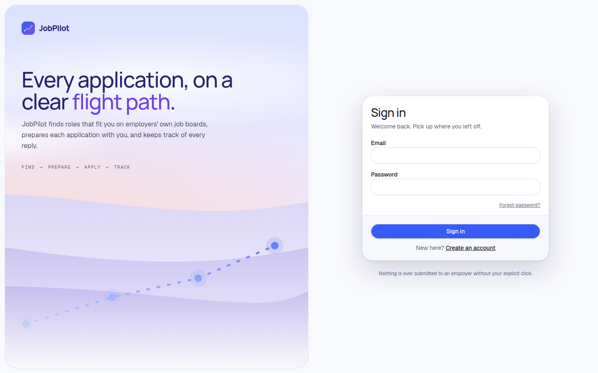

1. Open JobPilot.
2. Type your **Email** and **Password**.
3. Click **Sign in**.

You stay signed in on that browser until you sign out. Easy.

### Create an account
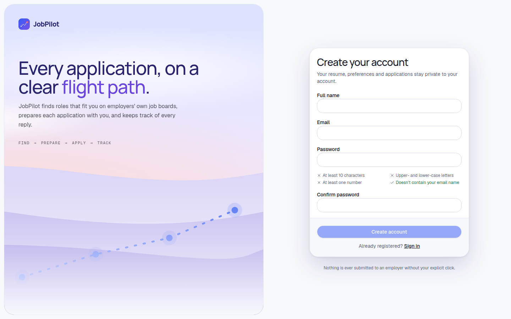

JobPilot is **invite-only**, so you need the invite code from whoever invited you.

1. Click **Create account** on the sign-in page.
2. Fill in your **Full name**, **Email** and a **Password**.
   - The password needs **at least 10 characters**, with **capital and small letters** and **a number**. It can't
     contain your email address. The little checklist under the box ticks green as you go.
3. Type the password again in **Confirm password**.
4. Enter your **invite code** and click **Create account**. You're in. Slay. 🎉

### Forgot your password?
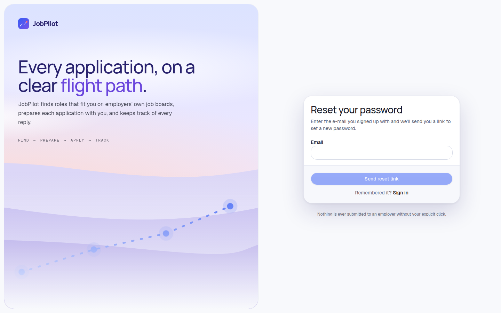

1. On the sign-in page, click **Forgot password?**
2. Type the email you signed up with and click **Send reset link**.
3. Open the email and follow the link to choose a new password.

> If no email arrives, ask the person who invited you. The server needs email set up to send reset links.

---

## 3. First-time setup

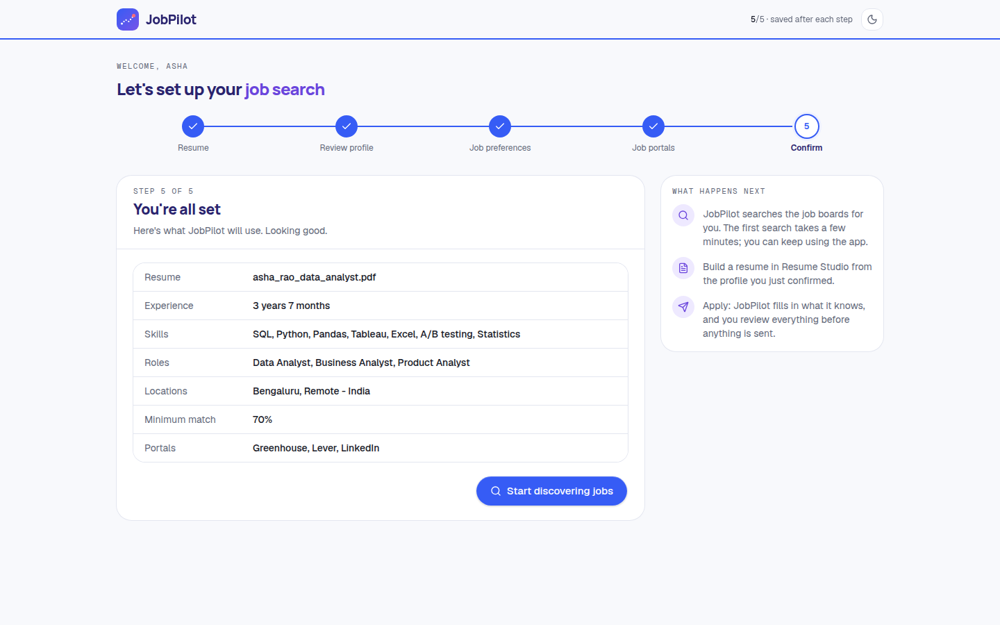

The first time you sign in, JobPilot walks you through **five short steps**. Each step saves as you go, so you can
leave and come back later without losing anything.

1. **Resume.** Upload your resume as a **PDF** or **Word (.docx)** file.
   - Two-column designs and Word tables work fine.
   - Scanned photos of a resume can't be read. Export a proper text PDF instead.
2. **Review profile.** JobPilot reads your resume and fills in your name, contact details, work history, education
   and skills. Fix anything that's off, and tick **current** next to the job you have now.
3. **Job preferences.** The job titles, cities, remote or office work, job type, experience level and salary you
   want.
4. **Job portals.** Pick the job sites you use, for example LinkedIn, Indeed and Naukri.
5. **Confirm.** You get one last summary of everything (the screenshot above). Click **Start discovering jobs**.

The first job search takes a few minutes, and you can use the rest of the app while it runs.

---

## 4. Finding your way around

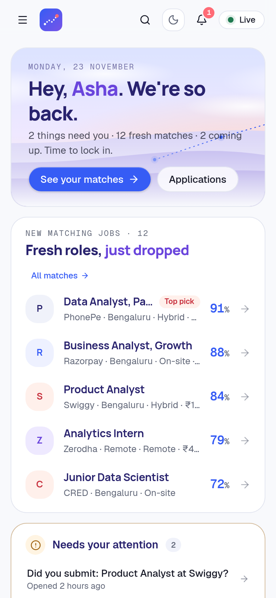

### The sidebar (left side)
| Menu | What's inside |
|---|---|
| **Home** | Your dashboard: what needs you today. |
| **Jobs** → Matches, Saved, Searches & companies | Finding jobs. |
| **Applications** → Pipeline, Outcomes & reports | Tracking what you've applied to. |
| **Career** → Resumes, Skills & learning, Interview practice, Plan & mentor, Work abroad | Levelling up. |
| **Settings** | Your profile and every setting. |

- All the sections stay open, so every page is one click away.
- The little button next to the JobPilot logo **collapses the sidebar** if you want more space.
- The numbers next to **Jobs** and **Applications** show how many things are waiting for you.
- Your name and email sit at the bottom.

### The top bar
- **Search or jump to…** (or press **Ctrl + K**, or **⌘ + K** on a Mac): type a page name or a job and jump straight
  there. Speedrun mode.
- **🌙 / ☀️**: switch between light and dark mode.
- **🔔 The bell**: your notifications, like new matches and reminders. A red number means unread ones.
- **Live** (green): JobPilot is connected and working. If it isn't, see the [FAQ](#20-faq-and-help-its-broken).

### On your phone
Everything works on mobile too. Tap **☰** (top left) to open the menu.

### Dark mode
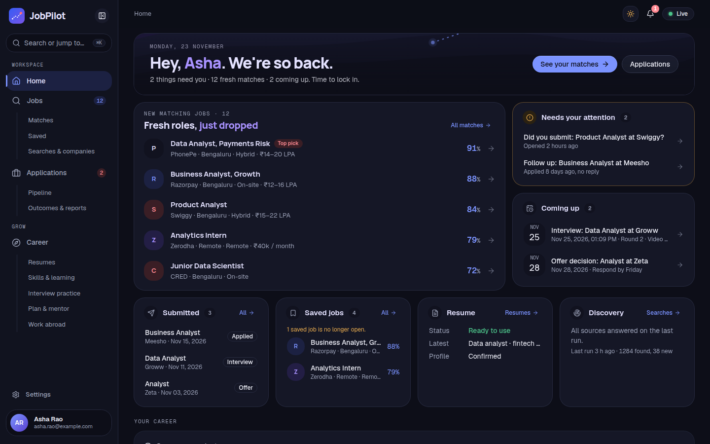

Click the moon icon. Your eyes at 2 a.m. will thank you. 🦇

---

## 5. Home: your dashboard

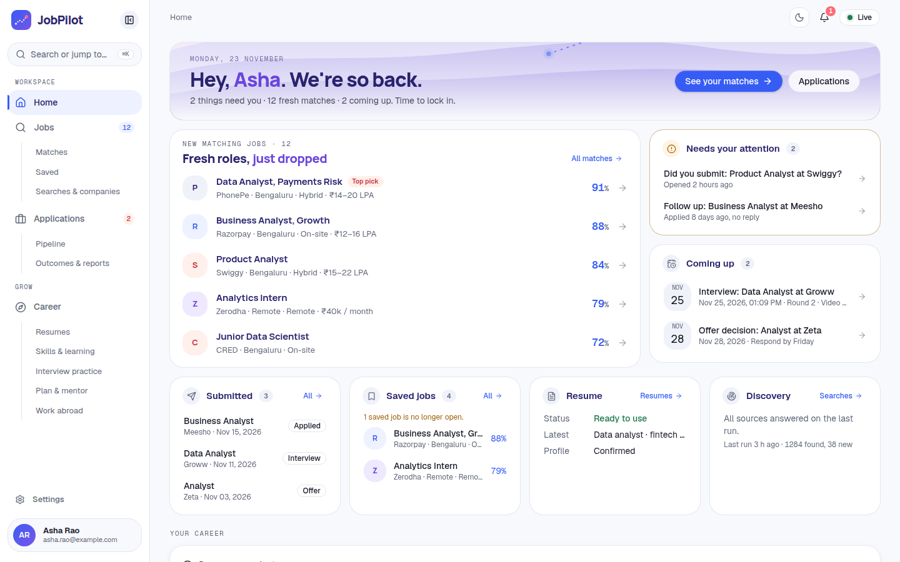

The **Home** page answers one question: *what should I do right now?* Click any line to jump straight to that job or
application.

- **The greeting** (*"Hey, Asha. We're so back."*) tells you, in one line, how many things need you, how many fresh
  matches you have and what's coming up. **See your matches** takes you to Jobs, and **Applications** to your
  pipeline.
- **Fresh roles, just dropped:** new jobs from the last 7 days that score at least your minimum match score and that
  you haven't opened yet. **Top pick** marks the best one. Change the minimum score in Settings → Job preferences.
- **Needs your attention:**
  - applications you opened but haven't told JobPilot about yet (*"Did you submit…?"*);
  - follow-ups that are due;
  - jobs you saved more than 3 days ago.
- **Coming up:** interviews and offer deadlines in the next 14 days.
- **Submitted:** your latest applications and the stage each one is at.
- **Saved jobs:** your saved jobs, with a warning if one is no longer open.
- **Resume:** whether your Resume Studio resume is ready to use.
- **Discovery:** when JobPilot last searched for jobs, and whether any source had problems.

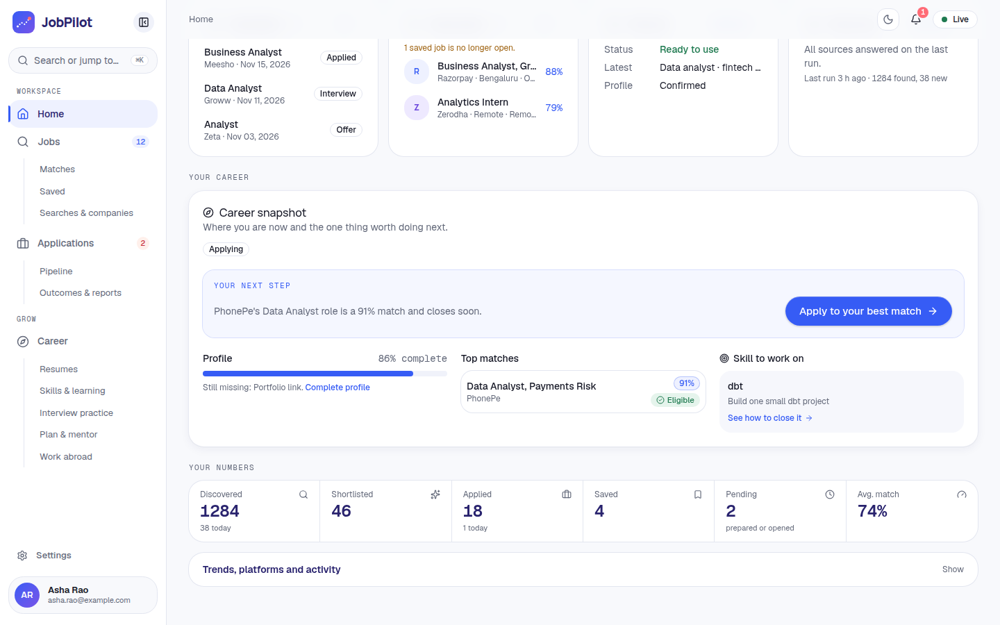

Scroll down for the rest:
- **Your career (Career snapshot):**
  - your **next step**, with a button to do it;
  - how complete your **profile** is;
  - your **top matches**;
  - the one **skill to work on** that would help most.
- **Your numbers:** jobs discovered, shortlisted, applied, saved, pending, and your average match score.
- **Trends, platforms and activity:** click **Show** for charts of your last 30 days.

---

## 6. Jobs → Matches

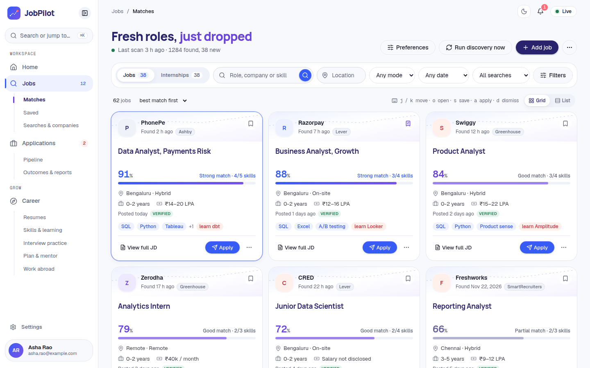

**Fresh roles, just dropped.** This is your job feed, best matches first.

### The top of the page
- **Last scan:** when JobPilot last searched, how many jobs it found, and how many are new.
- **Preferences:** change what you're looking for without leaving the page. Your match scores update after you save,
  and a short note tells you when the new scores are ready.
- **Run discovery now:** search right now instead of waiting for the daily run.
- **Add job:** paste a job link or job description you found yourself (for example on LinkedIn).
- **Jobs / Internships:** switch between full-time jobs and internships.
- **Search, Location, Any mode, Any date, All searches:** quick filters.
- **Filters:** all the filters (see below).
- **Grid / List:** cards or a compact list. Pick your aesthetic.

### Reading a job card
- **The big number (for example 91%)** is the match score, with a label such as *Strong match · 4/5 skills*.
  It's a guide for what to read first. It isn't a prediction that you'll get hired.
- **Where and what:** city, office/hybrid/remote, experience and salary.
- **Skill chips:** skills you have are plain. A skill marked *learn …* is one the job wants that you don't have yet.
- **Posted badges:**
  - **Verified:** the employer published that date.
  - **Estimated:** the date came from an alert email.
  - **Unknown:** no date was given.
- **Still-open badges** (hover over one to see when and how it was checked):
  - **Open:** seen on the employer's job page in the last few days.
  - **Not recently confirmed:** seen before, but not lately. Check it before you put in effort.
  - **Check on the site:** JobPilot can't check LinkedIn, Naukri or Indeed for you, so look there.
  - **Applications closed / No longer listed:** hidden unless you tick **Show closed and expired jobs** in Filters.
- **Places and pay are tidied up:**
  - "Bangalore" and "bengaluru, , India" both show as **Bengaluru, India**.
  - "$80K – $110K" shows as **USD 80k–110k a year**. Hover to see what the employer actually wrote.
  - Pay is never converted between currencies. **(assumed)** means the employer didn't say "per year", but the
    amount is clearly yearly.
- **Same job in several cities?** You see it **once**, with **Also listed in…** underneath. Tick **Show every
  listing separately** in Filters if you want them split.
- **Remote jobs** say who they're open to, for example **Remote (United States)**. A remote job that isn't open to
  your country gets a low location score.
- **Buttons on the card:** **View full JD**, **Apply**, **🔖 Save** and **⋯** (more, including **Dismiss** to hide a job for good).

### Open a job
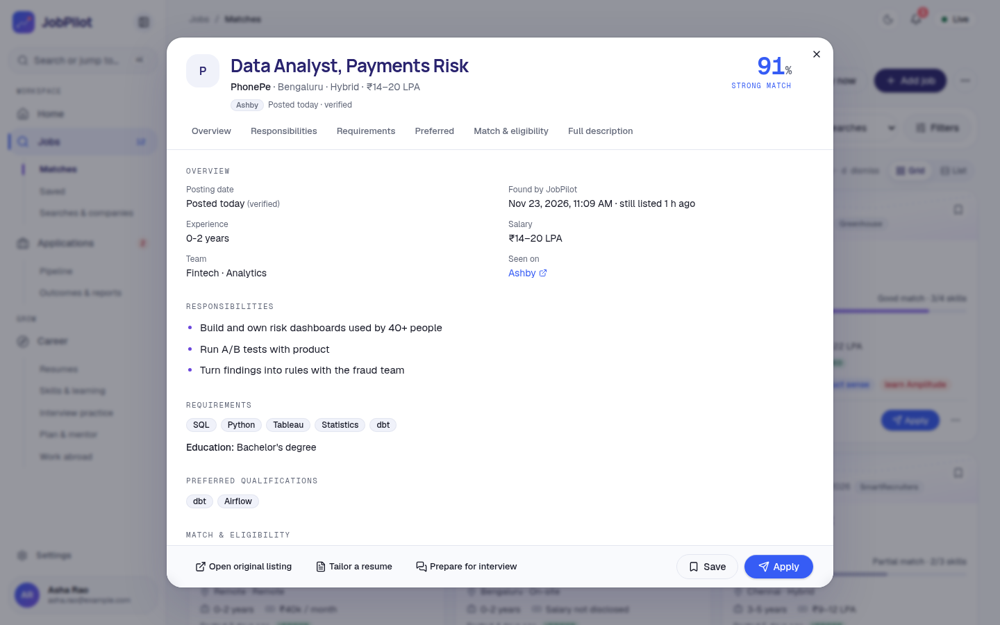

Click a job card to see everything about it:
- **Overview:** when it was posted, when JobPilot found it, experience, salary and where it was seen.
- **Responsibilities, Requirements** and **Preferred:** the job, split into easy chunks.
- **Match & eligibility:** *why* it matches you, in four lists:
  - **What matches**
  - **Partly matches**
  - **Doesn't match**
  - **Couldn't be checked:** for example, when the job doesn't state a salary. These don't count for or against you.
- **Full description:** the whole original text.

At the bottom: **Open original listing**, **Tailor a resume** (opens Resume Studio for this job), **Prepare for
interview**, **Save** and **Apply**.

### Filters
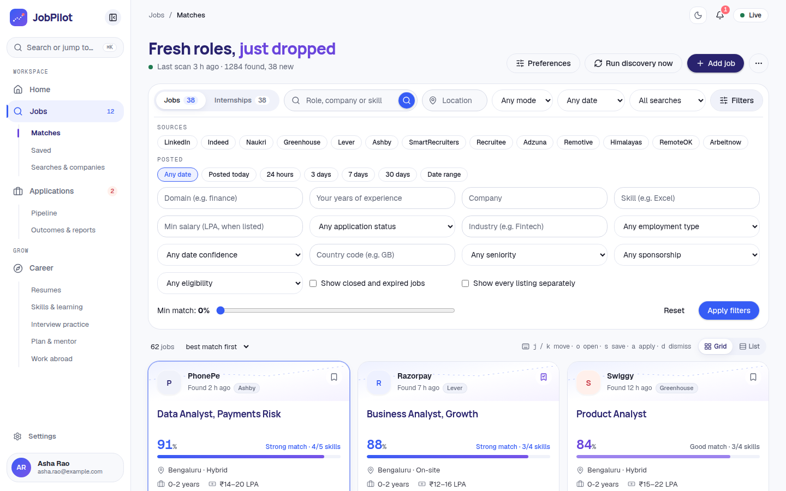

Click **Filters** to narrow things down by:
- where the job was found and when it was posted;
- domain, experience, company, skill, salary and industry;
- application status, job type, seniority, country, visa sponsorship and eligibility;
- a minimum match score.

Click **Apply filters** to use them, or **Reset** to clear them.

### Keyboard shortcuts (for the speedrunners)
| Key | Does |
|---|---|
| **j / k** | move down / up the list |
| **o** | open the job |
| **s** | save it |
| **a** | apply |
| **d** | dismiss it |

### On your phone
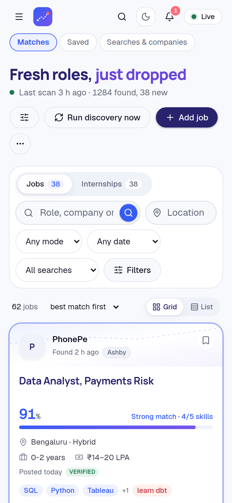

Same page, stacked for small screens. The tabs at the top switch between Matches, Saved and Searches & companies.

---

## 7. Applying for a job

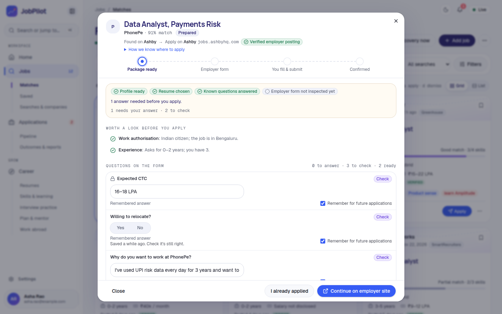

Click **Apply** on any job and JobPilot builds your **application pack**. The steps along the top show where you are:
**Package ready → Employer form → You fill & submit → Confirmed**.

### What's in the pack
- **Where you'll apply:** for example *Apply on Ashby*.
  - **Verified employer posting** means JobPilot checked it's the employer's real form.
  - Click **How we know where to apply** for the proof.
- **The readiness strip:** **Profile ready**, **Resume chosen**, **Known questions answered**, and how many answers
  **need you** or are **to check**.
- **Worth a look before you apply:** quick checks, for example whether you're allowed to work there and whether your
  experience fits.
- **Questions on the form:** your answers, ready to go.
  - Each answer says where it came from, for example **Remembered answer**.
  - **Check** means give it a look before you send it.
  - **Saved a while ago. Check it's still right.** means the answer might be out of date.
  - Tick **Remember for future applications** and you'll never type it again. 🙌
  - Personal questions such as gender, ethnicity, disability or veteran status are **never** filled in for you.
    Those are always yours to answer.

### The flow
1. Fill in anything marked as needing your answer.
2. Click **Continue on employer site**. The employer's application page opens.
   - On LinkedIn, Naukri and Indeed jobs, the button opens the job there instead. Those sites don't allow tools like
     this, so you apply yourself, with your details ready to copy.
3. Fill in the form, by hand or with the [Smart Apply extension](#18-the-smart-apply-browser-extension).
   **You press Submit yourself.**
4. Come back to JobPilot and say what happened:
   - **Yes, I submitted it.** Add the reference number if the employer gave you one.
   - **Not sure yet.** It stays as pending.
   - **I didn't apply.**

Already applied some other way? Click **I already applied** so your tracking stays accurate.

---

## 8. Jobs → Saved

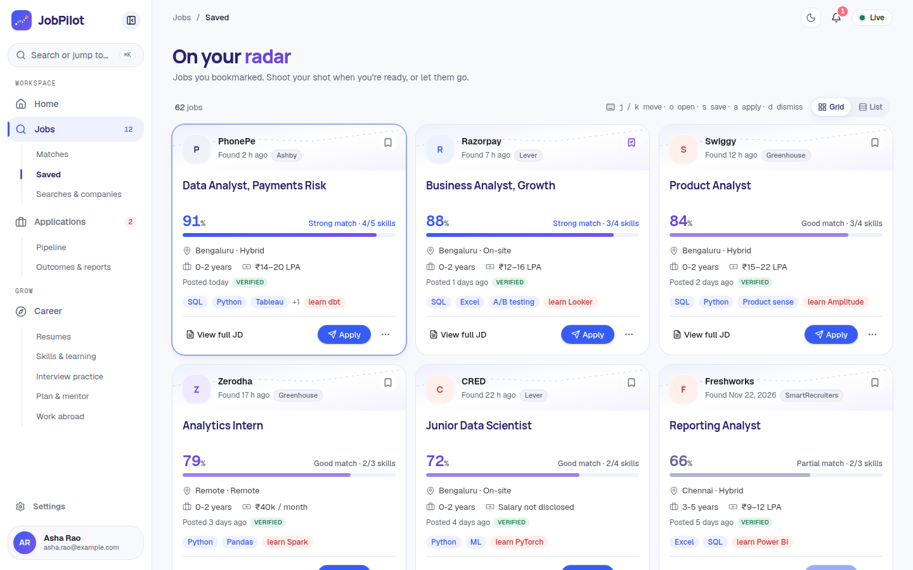

**On your radar.** Every job you've bookmarked lives here.
- The cards and buttons work just like in Matches.
- Shoot your shot when you're ready, or let them go with **Dismiss**.
- If a saved job closes, the Home page warns you.

---

## 9. Jobs → Searches & companies

This page decides **where** JobPilot looks. It has three tabs.

### Saved searches
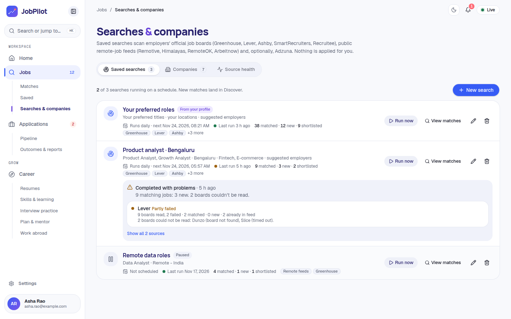

- **Your preferred roles** is made from your profile automatically.
- Click **New search** to add another, for example *Remote data roles*. Set the titles, places and how often it runs
  (daily or weekly).
- On each search:
  - **Run now** searches straight away.
  - **View matches** shows what that search found.
  - ✏️ edits it, and 🗑️ deletes it.
- After each run, JobPilot says where it looked and what it found. If something went wrong you see **Completed with
  problems**, with the details, for example a job board that couldn't be read.

### Companies
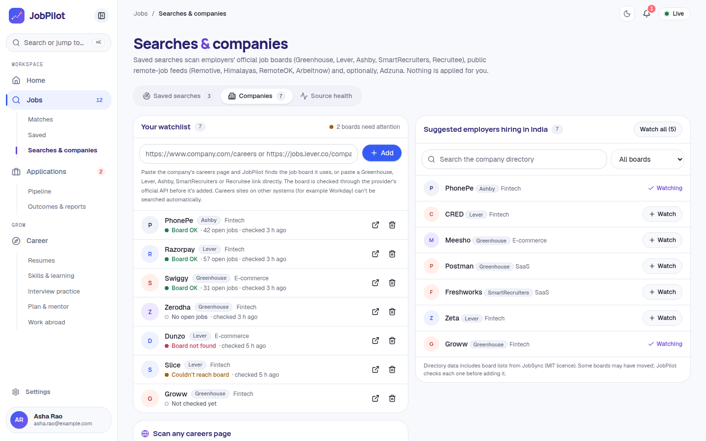

Stan a company? Follow it.
- **Your watchlist:** paste the link of a company's careers page and click **+ Add**. JobPilot works out which job
  system it uses and adds its jobs to your searches. This works for most companies that use common job systems
  (Greenhouse, Lever, Ashby, SmartRecruiters and more).
- **Suggested employers:** companies hiring in your area. Click **+ Watch** to follow one, or search the full company
  directory.
- **Scan any careers page:** try a link before you add it.

### Source health
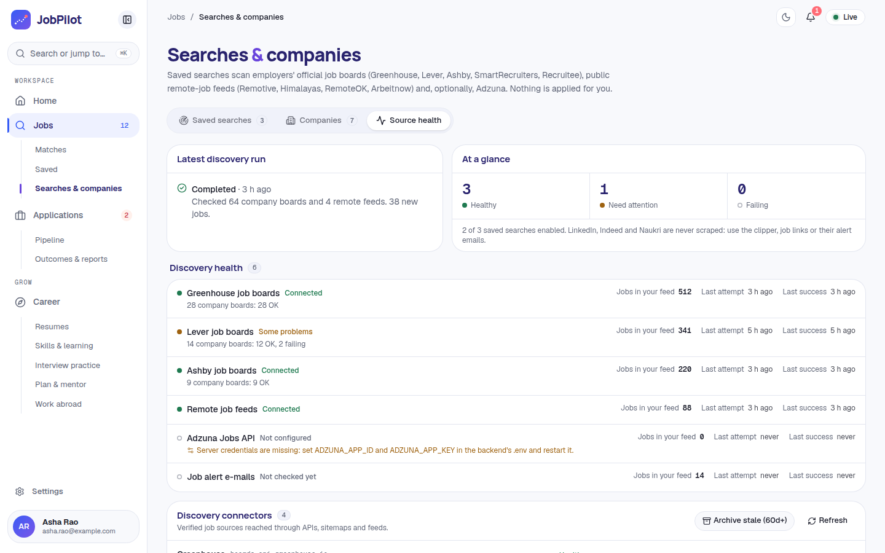

The "is everything working?" tab.
- **Latest discovery run:** when JobPilot last searched and what it found.
- **At a glance:** how many sources are healthy, need attention or are failing.
- **Discovery health:** every place JobPilot searches, with how many of your jobs came from it and when it last worked.

### Jobs you find yourself (LinkedIn, Indeed, Naukri)
JobPilot doesn't log in to these sites. When you spot a job you like there, either:
- click the **Clip to JobPilot** bookmark while you're on the job page (set it up in Settings → Platforms), or
- click **Add job** in JobPilot and paste the job link or description.

The job lands in your list so you can track it like any other.

---

## 10. Applications → Pipeline

**Every shot you've taken, and where it stands.** The counters at the top show how many applications are at each
stage: **Applied, Screening, Assessment, Interview, Offer** and **Closed**.

### List
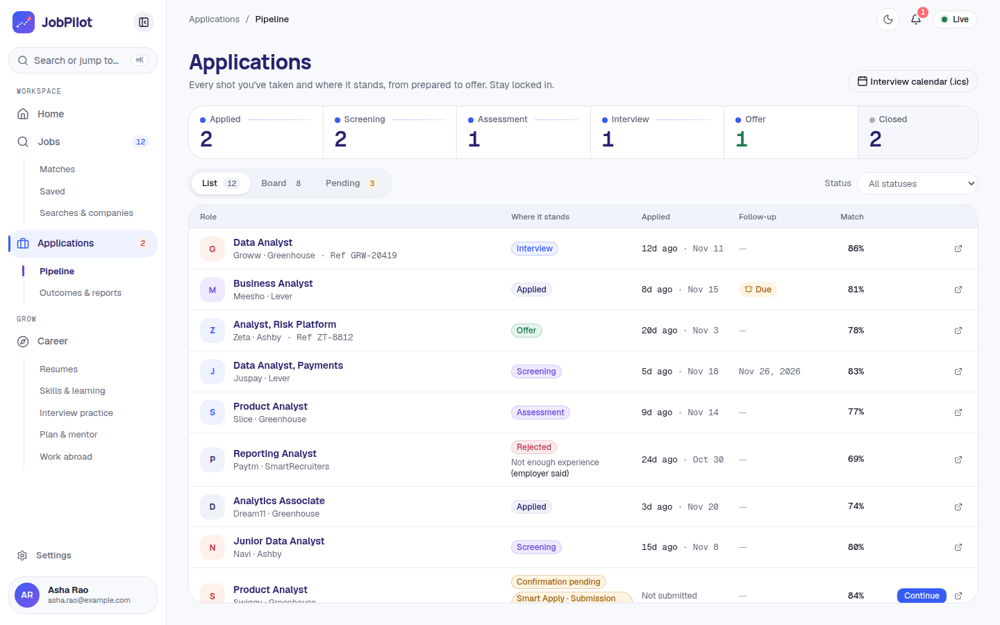

Every application in one table: the role, where it stands, when you applied, the follow-up date and the match score.
- An amber **Due** tag means it's time to follow up.
- Use **Status** (top right) to filter the list.

### Board
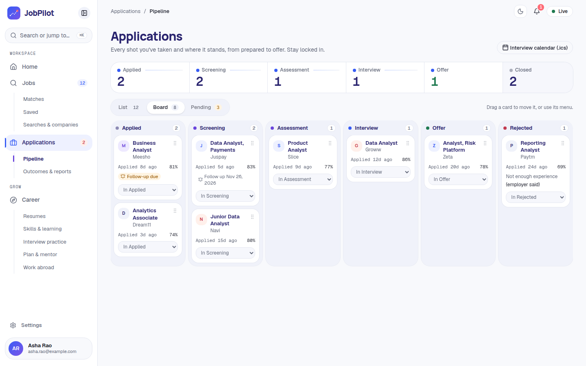

A board with one column per stage. When you hear back, move the card along:
- **drag** it to another column, or
- use the **stage menu** on the card (this works from the keyboard too).

Each card shows how long ago you applied, and **Follow-up due** when your reminder date arrives.

### Pending
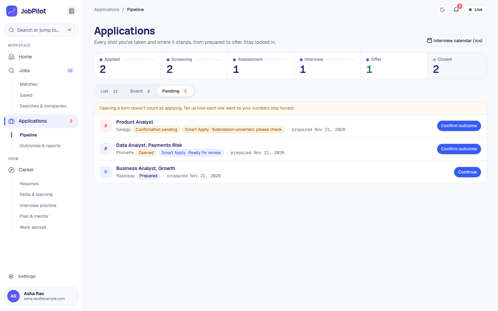

Applications you started but haven't confirmed yet.
- Click **Confirm outcome** to say whether you sent it, or **Continue** to pick up where you left off.
- Opening a form doesn't count as applying. Tell JobPilot how each one ended so your numbers stay accurate.

### One application, up close
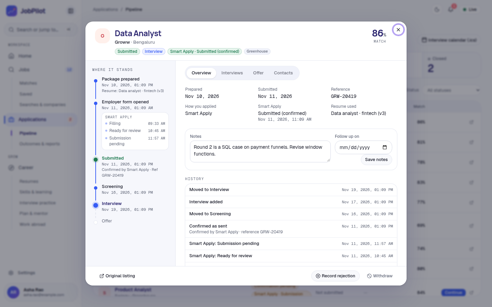

Click any application to see the full story.
- **Where it stands:** a timeline from *Package prepared* through to *Interview* or *Offer*.
- **How JobPilot knows you applied:**
  - **Confirmed by the employer's page**
  - **Receipt e-mail found**
  - **You told JobPilot (not verified)**: you marked it as applied yourself.
- **Overview:** when you applied, how you applied, the reference number and which resume you sent.
- **Notes** and **Follow up on:** write yourself notes and set a reminder date. Click **Save notes**.
- **History:** every change, in plain words, for example *Moved to Interview*.
- **Interviews:** add rounds with the date, interviewer names and the meeting link.
- **Offer:** record the salary, bonus, equity and the deadline to decide.
- **Contacts:** save the recruiter's details.
- At the bottom: **Original listing**, **Record rejection** and **Withdraw**.

Click **Interview calendar (.ics)** at the top of the page to add all your interviews to Google Calendar or Apple
Calendar.

---

## 11. Applications → Outcomes & reports

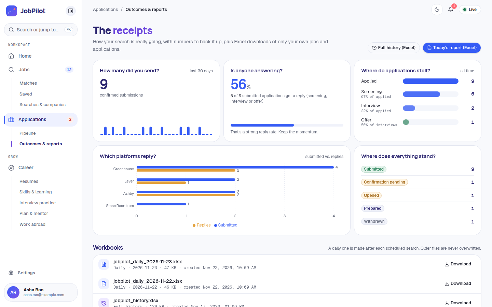

**The receipts.** How your search is *really* going, with numbers to back it up:
- **How many did you send?** Confirmed applications in the last 30 days.
- **Is anyone answering?** Your reply rate (screening, interview or offer).
- **Where do applications stall?** How many get from Applied to Screening, Interview and Offer.
- **Which platforms reply?** Applications sent vs. replies, per job site.
- **Where does everything stand?** Counts by status.

**Workbooks:**
- A spreadsheet of your jobs and applications is made after every daily search. Click **Download** next to one.
- **Today's report (Excel)** gets today's file, and **Full history (Excel)** gets everything.
- Older files are never overwritten.

---

## 12. Career → Resumes (Resume Studio)

### Your resumes
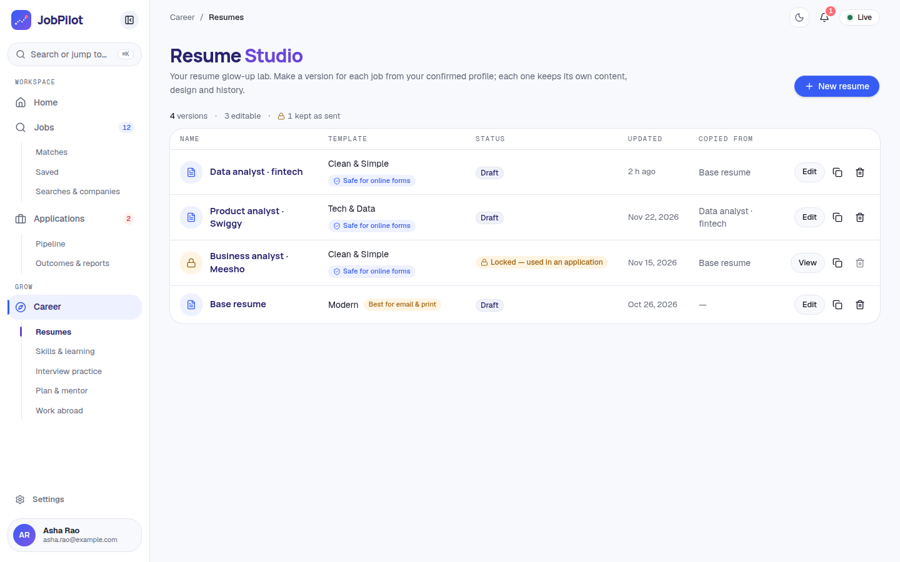

**Your resume glow-up lab.** Make a different version for each kind of job, all built from your confirmed profile.
- Click **New resume** and pick a template.
- Each version shows its template, its status and when you last changed it.
  - **Draft:** you can still edit it.
  - **Locked, used in an application:** it can't be edited, so you always know exactly what you sent. Make a copy to
    change it.
- Use the buttons on each row to **Edit**, **copy** or **delete** a version.

### Content: edit it
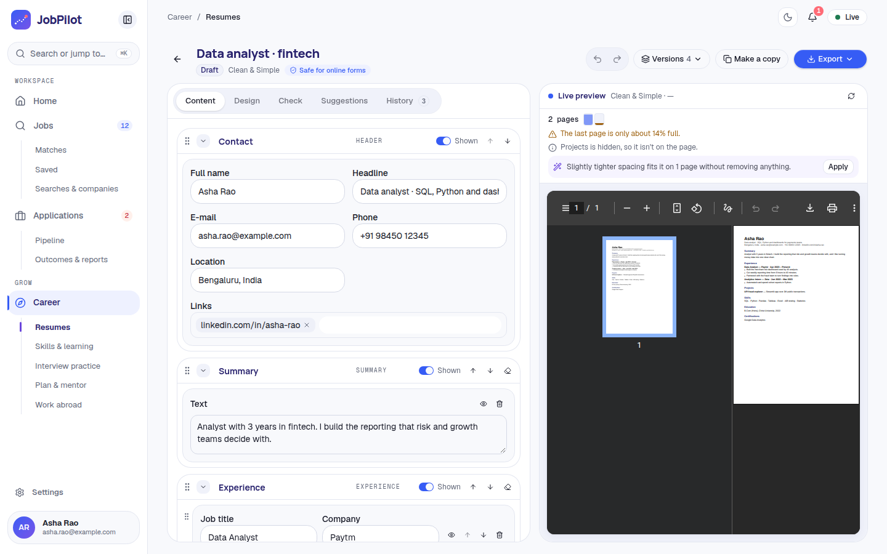

- Edit every section in the **Content** tab. Changes save on their own, and the top shows **Saved**.
- **Shown** switches a section on or off. Hidden sections stay saved, but they're not on the page.
- Drag the **⋮⋮** handle, or use the ↑ ↓ arrows, to reorder sections and entries.
- **Undo / Redo** are at the top, or press **Ctrl + Z** and **Ctrl + Shift + Z**.
- **The live preview** on the right *is* the real PDF.
  - Above it you see how many pages you have and how full each one is.
  - If the last page is nearly empty, JobPilot suggests a setting that fits everything on fewer pages. It changes
    nothing until you click **Apply**, and it never deletes your content.
- Top right: **Versions** (switch version), **Make a copy** and **Export** (download a **PDF** or **Word** file).

### Design: change the look
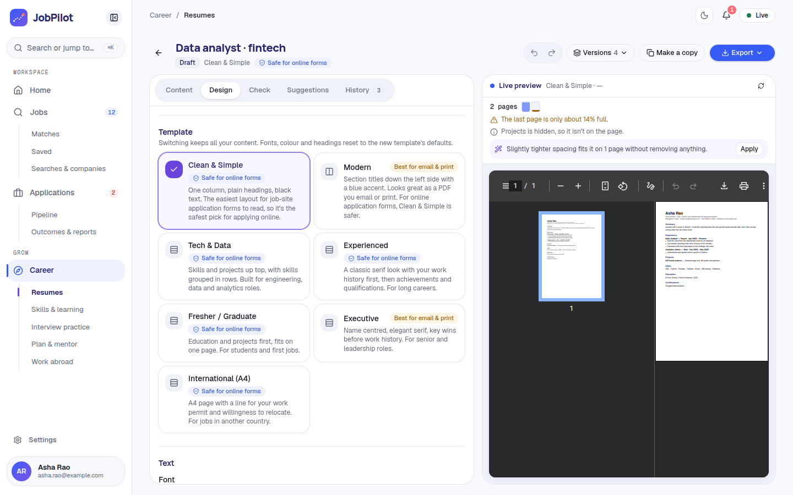

| Template | Best for |
|---|---|
| **Clean & Simple** | Online application forms. The safest pick. |
| **Modern** | Emailing or printing: section names in the margin and a colour accent. |
| **Tech & Data** | Engineering, data and analytics roles. Skills and projects come first. |
| **Experienced** | Long careers. A classic serif look. |
| **Fresher / Graduate** | Students and early careers. Education and projects first, aimed at one page. |
| **Executive** | Senior roles. Achievements come before experience. |
| **International (A4)** | Applying abroad. Adds a line for work permit or relocation. |

- **Safe for online forms** templates are the ones application robots (ATS) read best. **Best for email & print**
  ones look fancier for humans.
- You can also change:
  - the **font**, **text size**, **line spacing** and **date style** (Jan 2024, 01/2024 or 2024);
  - the **page size** (A4 or US Letter), **margins** and **spacing**;
  - the **heading style** and **accent colour**.
- Some limits keep it readable: form-safe templates keep text at 9.5 pt or bigger, and colours too pale to read
  aren't allowed.
- **Switching templates keeps all your content.** Experiment freely.

### Check: is it ready?
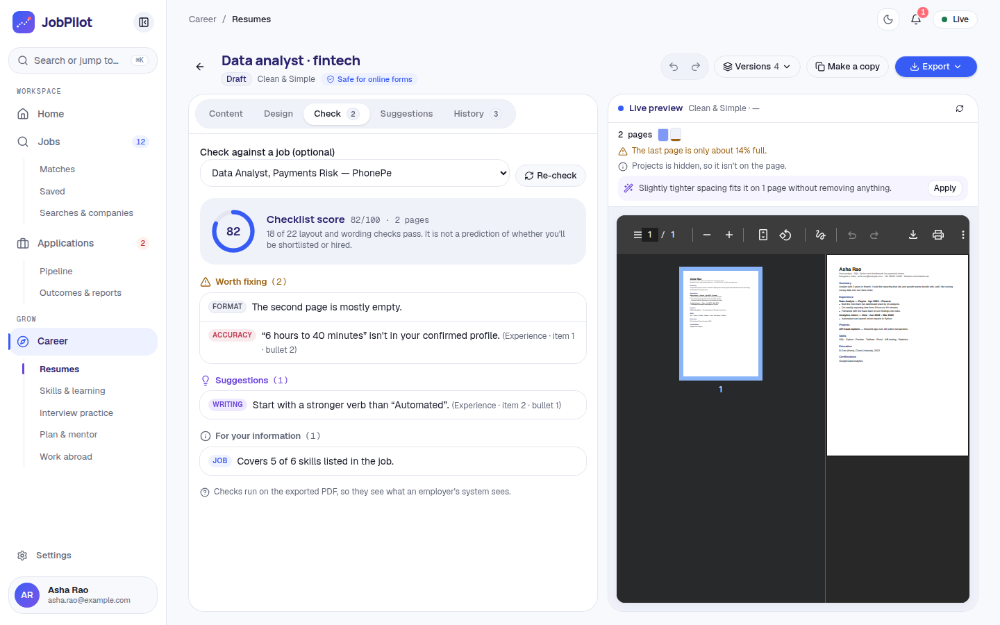

- Optionally pick a job under **Check against a job**, then click **Re-check**.
- **Worth fixing:** things JobPilot can actually check, for example:
  - a missing phone or email;
  - a job that ends before it starts;
  - the same bullet used twice;
  - emoji that forms may drop;
  - too many pages;
  - a number that isn't in your confirmed profile. Keep only what you can back up.
- **Suggestions:** writing tips, not rules.
- **For your information:** for example, how many of the job's skills your resume covers.
- **The Checklist score** is JobPilot's own checklist. It is **not** an "ATS score": no universal ATS score exists,
  whatever TikTok says. 🙃
- JobPilot also reads your exported PDF back, to make sure every job and bullet can be found in it.

### Suggestions: tailor it to a job
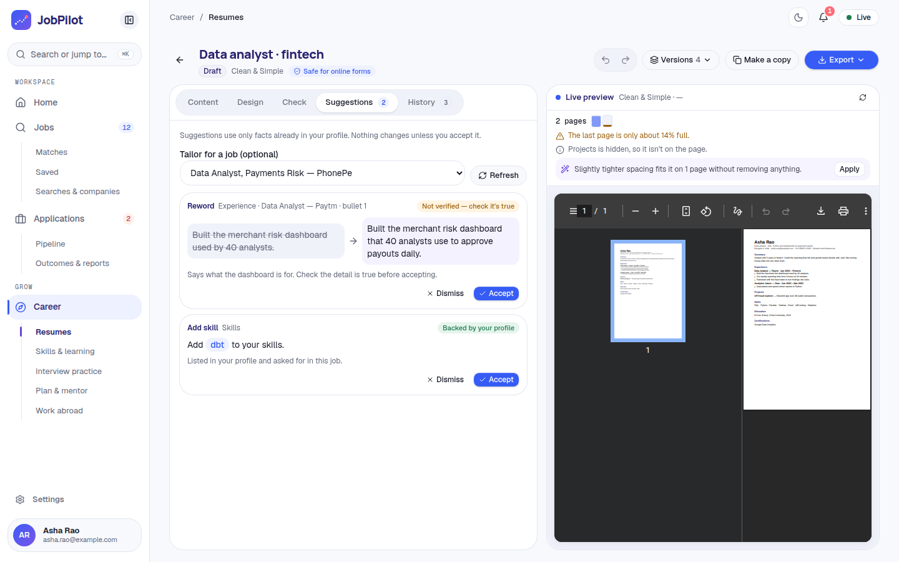

Pick a job under **Tailor for a job**. JobPilot can:
- **reword** a bullet so it fits the job better (marked **Not verified, check it's true**: only accept it if it is);
- **add a skill** the job wants, if it's already in your profile (**Backed by your profile**);
- put the job's skills first, and move your most relevant projects up.

It **never** invents skills, numbers or experience. Nothing changes until you click **Accept**, and **Dismiss** hides
a suggestion. To keep your main resume as it is, click **Make a copy** first.

**History** shows every saved change, so you can go back to an older one.

---

## 13. Career → Skills & learning

**Glow-up season. Let's level up.** The skills your target jobs keep asking for, the proof you already have, and a
short plan to close the gaps.

### Gaps
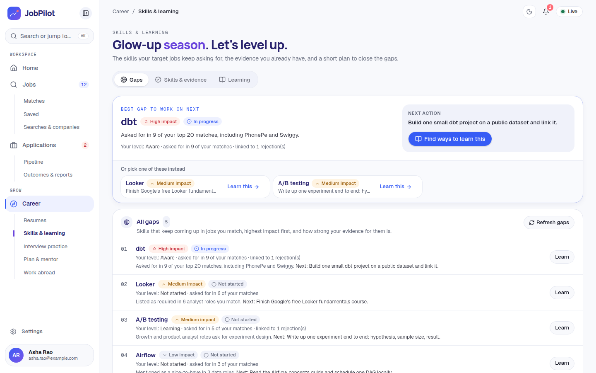

- **Best gap to work on next:** the one skill that would unlock the most jobs. It shows:
  - why it matters, for example *Asked for in 9 of your top 20 matches*;
  - your level;
  - a concrete **Next action**.

  Click **Find ways to learn this** to get started.
- **Or pick one of these instead:** other good options.
- **All gaps:** every missing skill, highest impact first, each with a **Learn** button.
- Click **Refresh gaps** after you change your profile.

### Skills & evidence
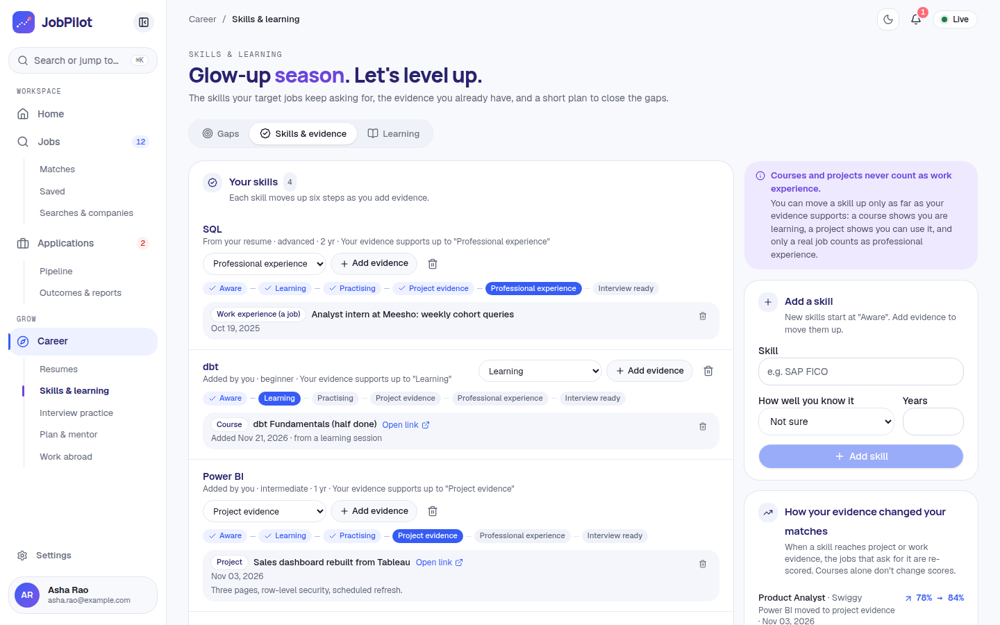

Every skill moves up six steps as you add proof:

**Aware → Learning → Practising → Project evidence → Professional experience → Interview ready**

- Click **+ Add evidence** on a skill to add a course, a project (with a link) or work experience.
- **Add a skill** (on the right) adds a new one. New skills start at *Aware*.
- **Courses and projects never count as work experience.** A course shows you're learning, a project shows you can
  use the skill, and only a real job counts as professional experience. No cap, no fake flexing.
- **How your evidence changed your matches:** when a skill reaches project or work evidence, the jobs that ask for it
  are re-scored, so you can watch your match scores go up. 📈

### Learning
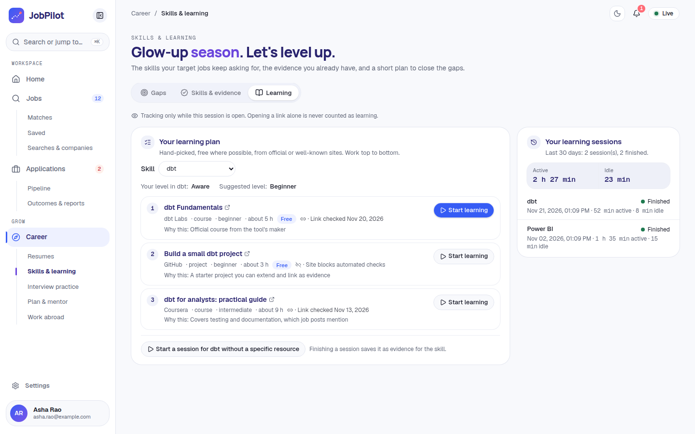

- **Your learning plan:** pick a **Skill** and you get hand-picked resources, free where possible, from official or
  well-known sites. Work through them from top to bottom.
- Click **Start learning** to open a resource and start a **learning session**. When you finish the session, it is
  saved as evidence for that skill.
- **Your learning sessions:** your last 30 days, with active time and idle time.
- Tracking only runs while the session is open. Just opening a link is never counted as learning.

---

## 14. Career → Interview practice

**Walk in with main-character energy.**

### Pick a job
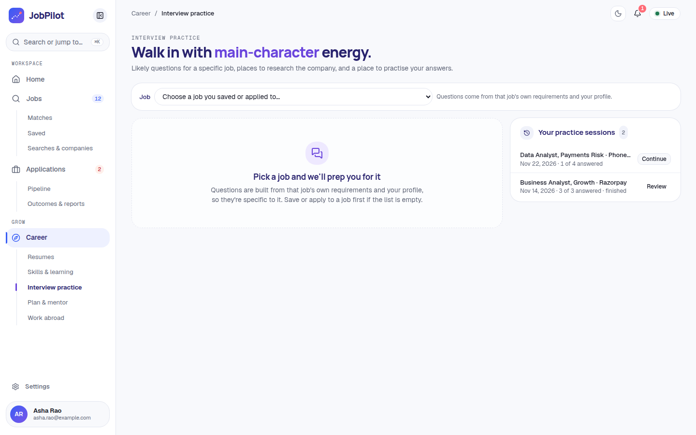

Choose a job you saved or applied to from the **Job** menu. **Your practice sessions** (on the right) lets you
**Continue** or **Review** earlier ones.

### Your question set
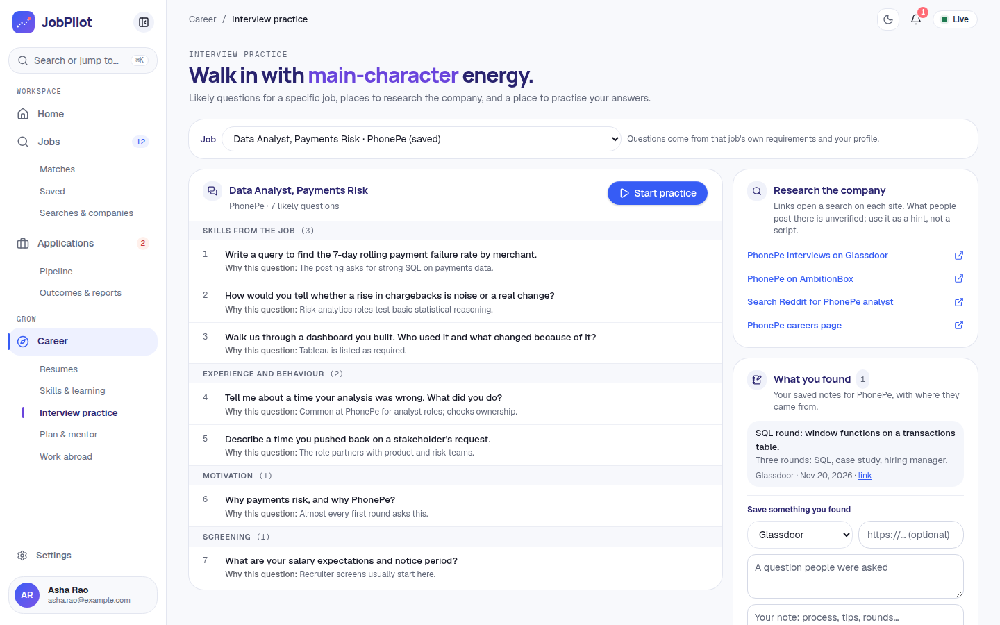

- **Likely questions**, grouped into **Skills from the job**, **Experience and behaviour**, **Motivation** and
  **Screening**. Each one says **Why this question**, so you know where it came from.
- **Research the company:** links that open a search on Glassdoor, AmbitionBox, Reddit and the company's own careers
  page. What people post there is unverified, so treat it as a hint, not a script.
- **What you found:** save notes from your research (where you found it, the question people were asked, your
  notes), so it's all in one place.
- Click **Start practice** when you're ready.

### Practise
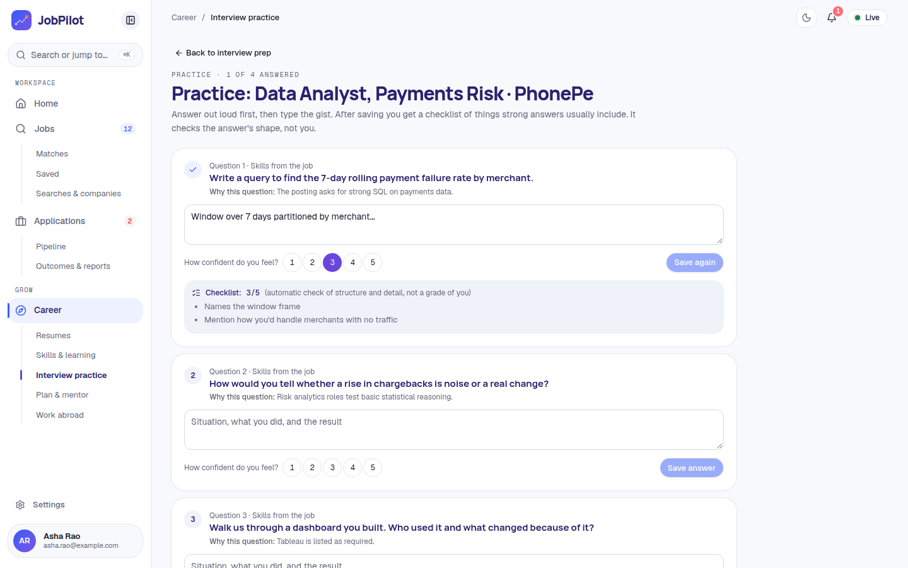

1. Say your answer **out loud** first (yes, really), then type the gist in the box.
2. Pick **How confident do you feel?** from 1 to 5.
3. Click **Save answer**. You get a **checklist** of things strong answers usually include, for example *Names the
   window frame*.

The checklist checks the *shape* of your answer, not you. It's practice, not a test. You've got this. 💪

---

## 15. Career → Plan & mentor

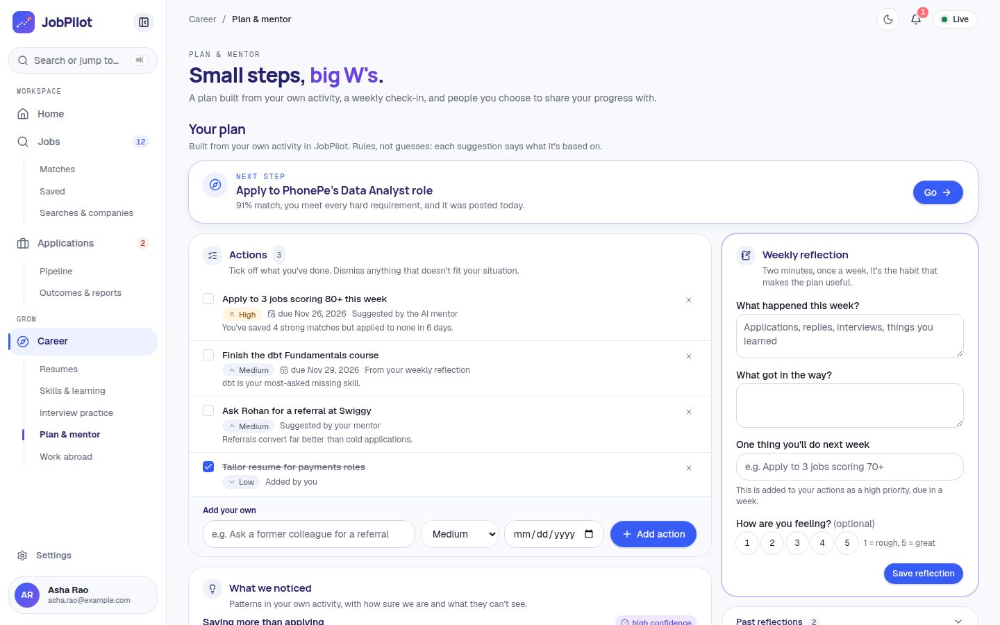

**Small steps, big W's.** A plan built from your own activity, plus a weekly check-in.
- **Next step:** the single most useful thing to do now, with the reason. Click **Go**.
- **Actions:** your to-do list.
  - Tick things off as you do them, or ✕ to dismiss anything that doesn't fit your situation.
  - Each action says where it came from: your weekly reflection, your mentor, or the suggestion engine.
  - Add your own under **Add your own**, with a priority and a due date.
- **Weekly reflection:** two minutes, once a week. What happened, what got in the way, and one thing you'll do next
  week. That last one becomes a high-priority action. How you're feeling is optional. Click **Save reflection**.
- **What we noticed:** patterns in your activity, for example *saving more than applying*, with how sure JobPilot is.
- **Past reflections:** your earlier check-ins.

### Your mentors
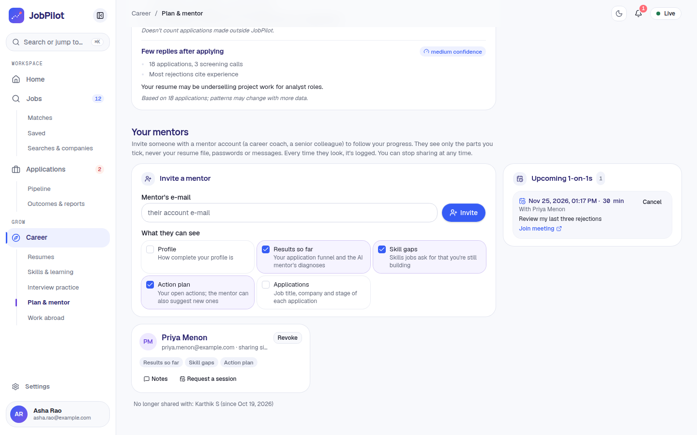

Got a career coach or a senior colleague in your corner? Invite them to follow your progress. They need a JobPilot
mentor account, and **Sharing with mentors** must be switched on in Settings → Privacy & consent.

1. Under **Invite a mentor**, type their account email.
2. Tick **What they can see**: Profile, Results so far, Skill gaps, Action plan and Applications. They see **only**
   what you tick, and never your resume file, passwords or messages.
3. Click **Invite**.

What you can do once they're in:
- **Mentor card:** the mentor's card shows what they can see. **Notes** opens your notes together, and **Request a
  session** books a 1-on-1.
- **Upcoming 1-on-1s:** your booked sessions, with the meeting link.
- **Logged access:** every time a mentor looks at your progress, it's logged.
- **Revoke:** stops sharing straight away.

### Mentoring (for mentors)
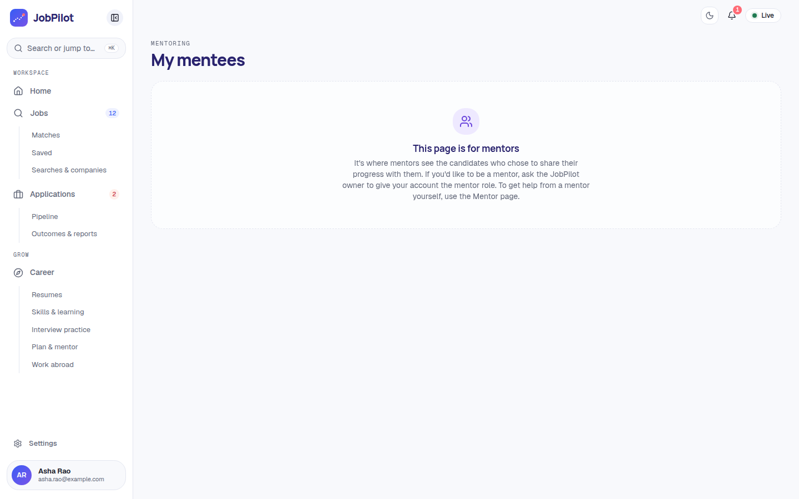

**My mentees** is for mentors only. It lists the people who chose to share their progress with you. If you'd like to
mentor someone, ask the person who runs your JobPilot to give your account the mentor role.

---

## 16. Career → Work abroad

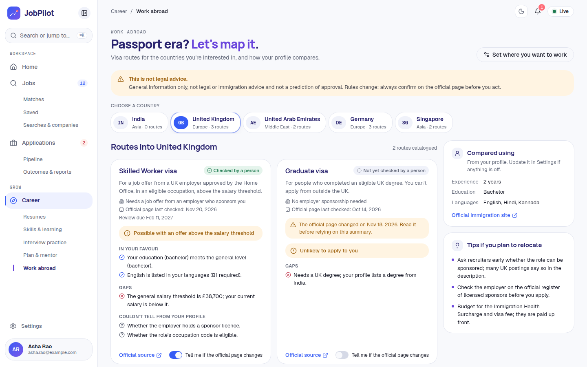

**Passport era? Let's map it.** ✈️ Visa routes for the countries you're interested in, and how your profile compares.

> ⚠️ **This is not legal advice.** It's general information, not immigration advice, and not a prediction of
> approval. Rules change: always confirm on the official page before you act.

1. Click **Set where you want to work** to choose your countries (this is also in Settings → Career goals).
2. Pick a country under **Choose a country**.
3. Each **route** (for example *Skilled Worker visa*) shows:
   - what it's for, and whether you need an employer to sponsor you;
   - **Checked by a person** or **Not yet checked by a person**, and when the official page was last checked;
   - a verdict, such as **Possible with an offer above the salary threshold** or **Unlikely to apply to you**;
   - **In your favour**, **Gaps** and **Couldn't tell from your profile**;
   - **Official source**, plus a switch: **Tell me if the official page changes**.
4. **Compared using** shows the profile details the comparison used. If any are wrong, fix them in Settings.
5. **Tips if you plan to relocate** gives practical advice for that country.

---

## 17. Settings, every section

**Your setup, your rules.** Everything here is private to your account. Pick a section on the left.

### My profile → Resume & profile
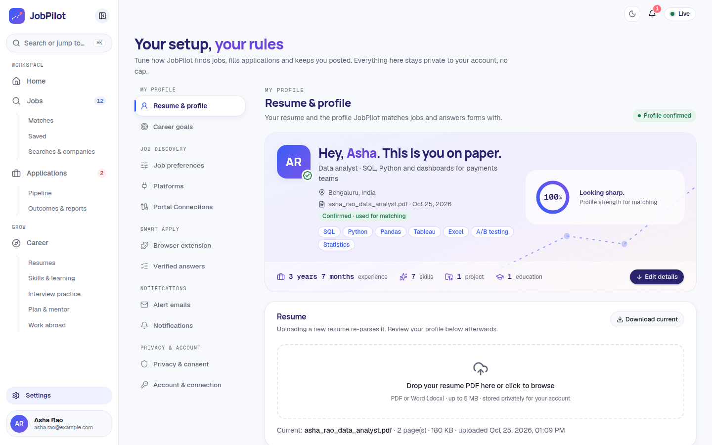

- **Hey, [you]. This is you on paper.** This is your profile at a glance. The ring shows **profile strength**, and
  **Edit details** takes you to the form.
- **Resume:** drop in a new PDF or Word file, or click **Download current**.
- **Resume versions:** keep different resumes (for example one for finance, one for operations), choose your
  **default**, and preview, download, rename or delete them.
- **Candidate profile:** your details, used for matching and for answering application questions.
  - Add your **LinkedIn, GitHub, portfolio or website** links.
  - Saving re-scores your open jobs.
- **After you upload a resume,** check what JobPilot read from it. Nothing is used until you click **Save**. The
  labels tell you what needs a look:
  - **From resume:** read from your resume. Check it.
  - **Missing:** add it yourself.
  - **Resume differs:** a newer resume says something else.
  - **Check again:** you confirmed it a long time ago.
- **A new resume never changes your saved profile by itself.** Where it differs, you see what the new one says, with
  **Use this** or **Add** buttons. Take what's right, then save.

### My profile → Career goals
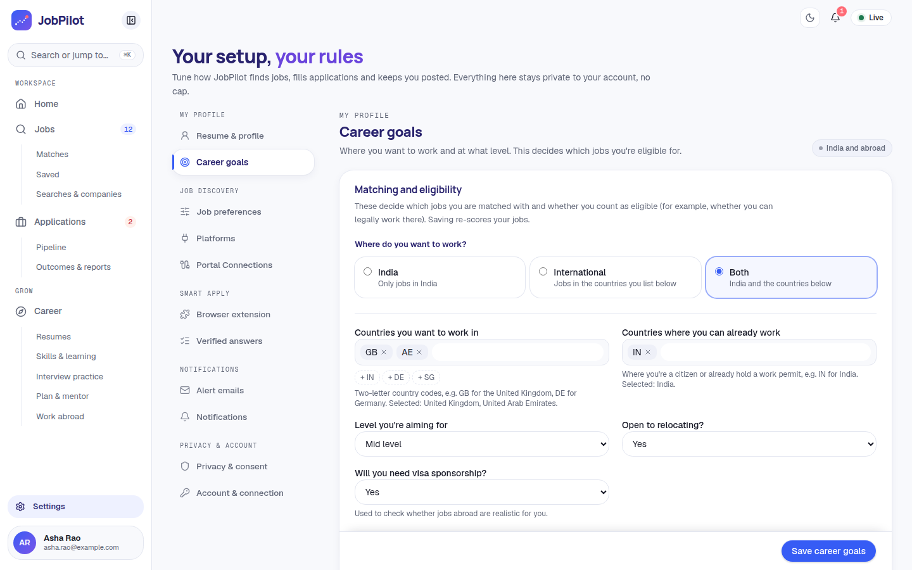

- **Where do you want to work?** **India**, **International** or **Both**.
- **Countries you want to work in** and **countries where you can already work.**
- **Level you're aiming for**, **Open to relocating?** and **Will you need visa sponsorship?**

These decide which jobs you're matched with and whether you count as eligible. Click **Save career goals**.

### Job discovery → Job preferences
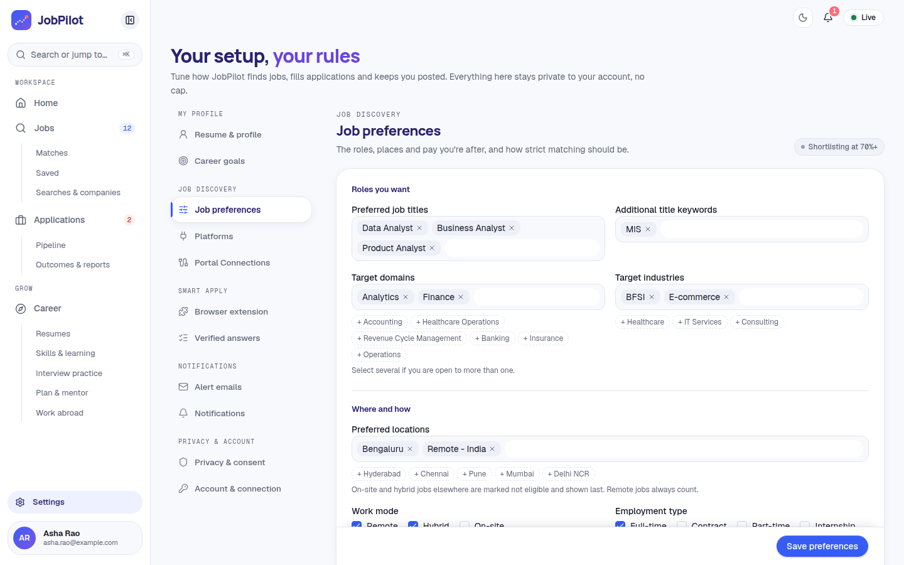

- **Roles you want:** job titles, extra title keywords, target domains and industries. Click the suggestions to add
  them.
- **Where and how:** cities, work mode (remote, hybrid, on-site) and employment type.
- Further down: salary, experience, notice period, companies you like or want to avoid, and the minimum match score.

Click **Save preferences**. Your match scores refresh, and you get a note when they're ready.

### Job discovery → Platforms
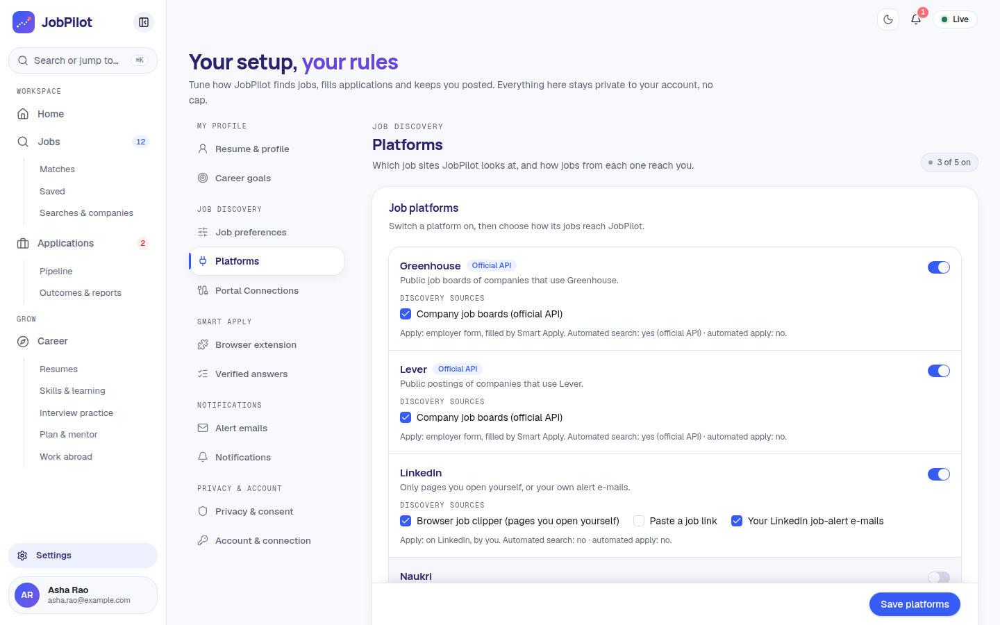

Switch each job site on or off, and choose how its jobs reach you.
- **Greenhouse** and **Lever** search companies' job boards automatically, using official public listings.
- **LinkedIn**, **Naukri** and **Indeed** can bring jobs in three ways:
  - the **browser job clipper**, for pages you open yourself;
  - **pasting a job link**;
  - **their job-alert emails** (set them up in Alert emails).
- The **Clip to JobPilot** bookmark lives here.

Click **Save platforms** when you're done.

### Job discovery → Portal Connections
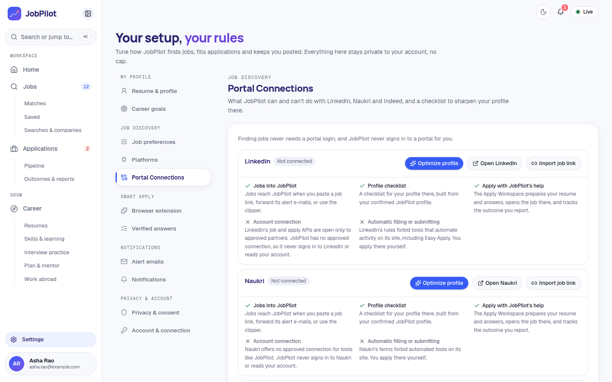

Three cards, one per site: **LinkedIn**, **Naukri**, **Indeed**. Each one shows where it's at, one big button for
the main move, and a couple of extras. No wall of text, no cap.

What the status means:
- **Ready to connect:** hit **Connect with LinkedIn** (or Indeed). It opens **their** sign-in page. Already signed in
  there? Just click Allow. JobPilot never sees your password or OTP.
- **Connected:** your name and email from that site show up on the card. That's all linking shares, and it **never**
  overwrites your JobPilot profile.
- **Connected with limited permissions:** you skipped something on their page. Reconnect and allow it if you want.
- **Reconnect required:** access ran out or you removed JobPilot over there. Hit **Reconnect**.
- **Not configured:** whoever runs your JobPilot hasn't turned that sign-in on yet. Not a bug. Everything else on the
  card still works.
- **Opens in browser** (Naukri): Naukri has no sign-in for apps, so **Open Naukri** just opens naukri.com in a new tab.
  Sign in there like normal, then come back.
- Anything labelled **(simulated)** is a fake test login, not your real account. Ignore it.

Buttons you'll see:
- **Import … job:** paste a job link, JobPilot spots the site and job ID, you add the title and description, check
  it, then save. Link not recognised? Type the details in yourself.
- **Prepare application:** pick one of that site's jobs and jump into the Apply Workspace.
- **Manage connection:** check it still works, reconnect, or disconnect (it asks first, then deletes its access).
- **Profile checklist** (LinkedIn and Naukri) and **Capabilities & limitations** (what works, what doesn't, and why).

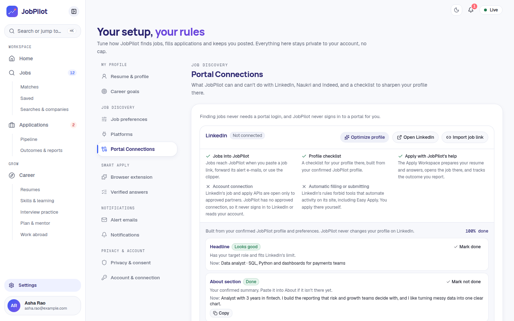

The **Profile checklist** is built **only** from details you already confirmed:
- Each item says **Looks good**, **Improve** or **Missing**, and why.
- **Copy** gives you ready-to-paste text.
- Click **Mark done** as you finish each one. The bar shows how far along you are.

JobPilot never changes your profile on those sites. You do the pasting.

Under the cards, **Find or import jobs** has every way in: browse the jobs you already have from each site, import a
link, set up the clipper, or connect your job-alert mailbox. Then it's **Prepare application** → pick your resume →
answers → open the job on the site → tell JobPilot how it went.

Running JobPilot for your crew? Admins also get **Set up LinkedIn / Set up Indeed**: a step-by-step panel with the
developer-app links, the exact callback URL to copy, a spot for the app's keys, and **Test connection** to try it for
real.

### Smart Apply → Browser extension
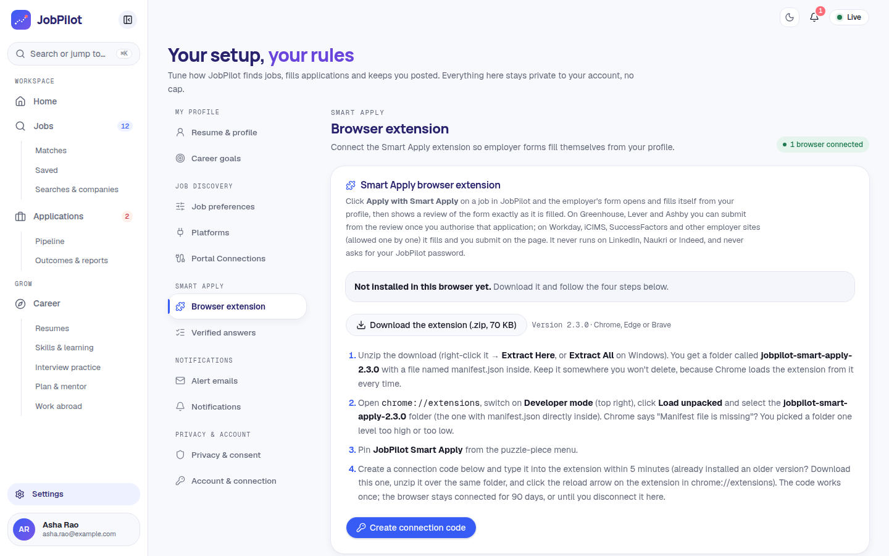

Set up the Smart Apply helper here. There are full steps in
[section 18](#18-the-smart-apply-browser-extension).
- **Download the extension** gets the zip file. The page shows the current version, which is **2.3.0**.
- Follow the four numbered steps on the page.
- **Create connection code** gives you the code that connects the extension to your account.
- Connected browsers are listed here. Click **Disconnect** to remove one.

### Smart Apply → Verified answers
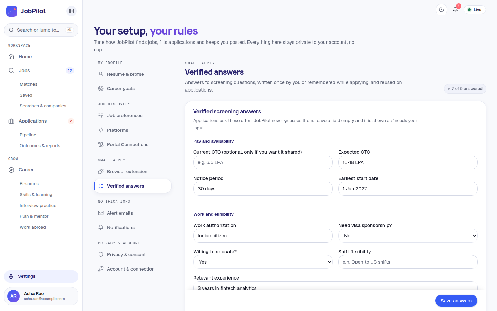

Application forms keep asking the same questions. Answer them **once** here:
- current salary (optional, and only if you want it shared) and expected salary;
- notice period and earliest start date;
- your work authorization, whether you need visa sponsorship, whether you'd relocate, and shift flexibility;
- relevant experience, and more.

JobPilot **never guesses** these. If you leave one empty, it's shown as "needs your input". Click **Save answers**.

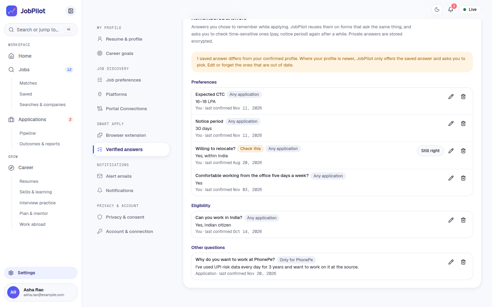

**Remembered answers:** answers you chose to remember while applying.
- **Any application** means the answer is reused everywhere. **Only for PhonePe** (for example) means it's only used
  for that employer.
- **Check this** means the answer might be out of date, for example pay or notice period after a while. Click **Still
  right** if it is.
- ✏️ edits an answer and 🗑️ forgets it.
- **The orange note** appears when a saved answer differs from your profile, for example after you changed jobs.
  JobPilot then asks you which one to use instead of guessing.

### Notifications → Alert emails
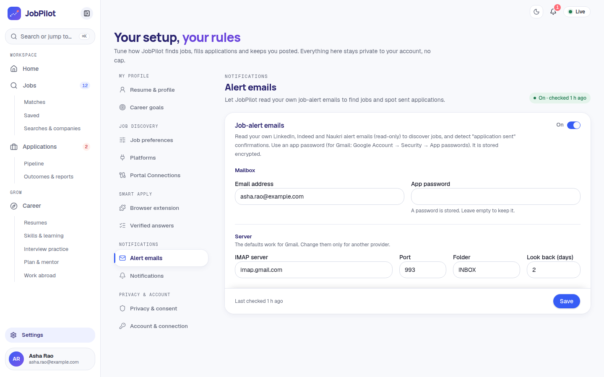

Optional. Connect the inbox where you get job alerts from LinkedIn, Indeed or Naukri. JobPilot reads those alerts
(read-only) to find jobs and spot "application received" emails.
- **Email address** and **App password**:
  - use an *app password*, not your normal password;
  - for Gmail, create one under Google Account → Security → App passwords;
  - it's stored encrypted.
- **Server settings** default to Gmail. Change them only if you use another email provider.
- Switch it on, then click **Save**. **Last checked** tells you it's working.

### Notifications → Notifications
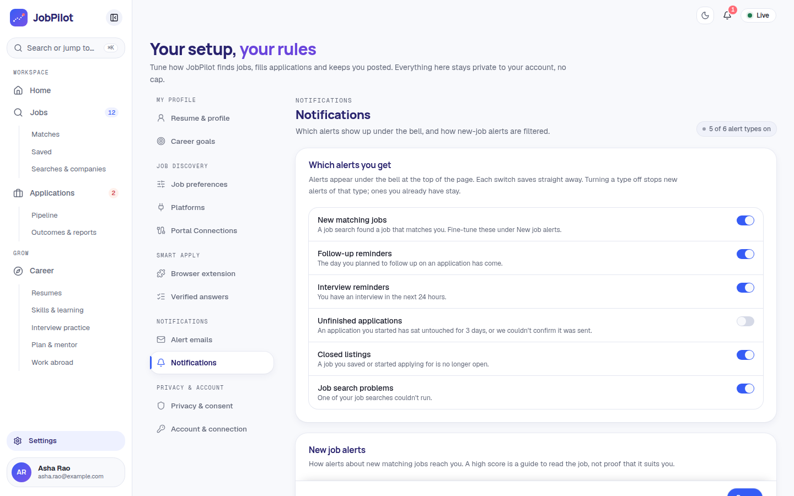

- **Which alerts you get:** switch each one on or off:
  - new matching jobs;
  - follow-up reminders;
  - interview reminders;
  - unfinished applications;
  - closed listings;
  - job search problems.

  Each switch saves straight away.
- **New job alerts:** get one alert per job or one summary a day, and choose how good a match must be before you're
  told. A high score helps you decide what to read first. It isn't proof that the job suits you.

### Privacy & account → Privacy & consent
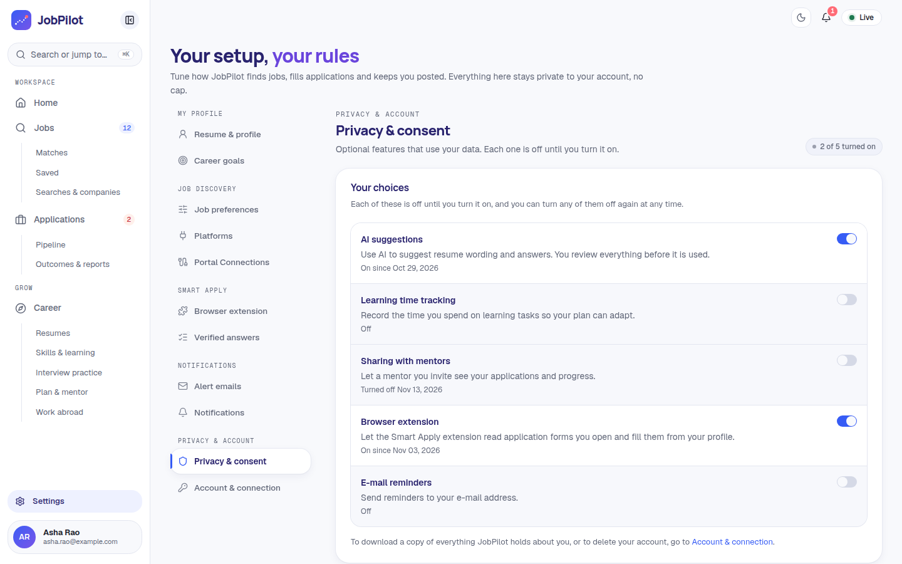

Optional features that use your data. **Each one is off until you turn it on**, and you can turn it off again
anytime:
- **AI suggestions:** suggested wording for your resume and answers. You review everything before it's used.
- **Learning time tracking:** records the time you spend on learning tasks, for your plan.
- **Sharing with mentors:** a mentor you invite can see your applications and progress.
- **Browser extension:** lets Smart Apply read application forms you open and fill them from your profile.
- **E-mail reminders:** reminders sent to your email address.

### Privacy & account → Account & connection
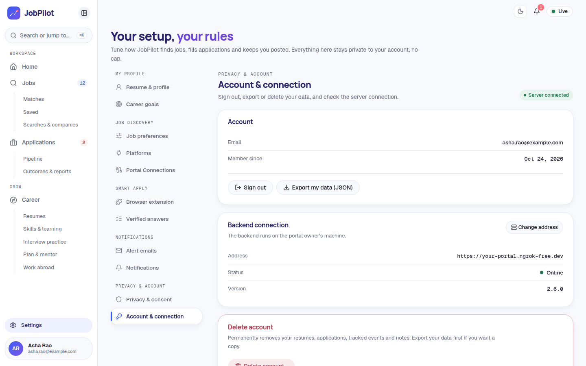

- **Account:** your email address and when you joined.
- **Sign out.**
- **Export my data (JSON):** download a full copy of everything JobPilot has about you: resumes, profile,
  applications, notes, interviews and offers. Your data, your rules.
- **Backend connection:** the server JobPilot talks to, and whether it's online. You don't normally need to touch
  this. If the person who runs JobPilot gives you a new address, click **Change address**.
- **Delete account:** permanently deletes your account and all your data. Type your password to confirm. It can't
  be undone, so export your data first if you want a copy.

---

## 18. The Smart Apply browser extension

A free helper for **Chrome** or **Edge** that fills in application forms for you, shows you everything before you
send it, and keeps your JobPilot list up to date. It's like autofill, but it actually knows you. 🤖

| Site | What it does |
|---|---|
| **Greenhouse, Lever, Ashby** | Fills the form, and can send it for you, but **only** after you've checked it and clicked **Submit this application**. |
| **Workday, iCIMS, SuccessFactors, Taleo, other company sites** | Fills the form. You press the site's own Submit button. |
| **LinkedIn, Naukri, Indeed** | Nothing automatic: these sites don't allow helpers like this. JobPilot shows your details to copy and lets you download your resume. |

> 🔄 **Already have version 2.2.0?** Update to **2.3.0**, because the old version can no longer connect.
> 1. Download the new zip from Settings → Browser extension.
> 2. Unzip it over your old folder.
> 3. Click the **reload** arrow on the extension in `chrome://extensions`.

### Set it up once
1. Go to **Settings → Browser extension** and click **Download the extension**.
2. Unzip it. Right-click the file and choose **Extract Here** (on Windows, **Extract All**). You get a folder called
   **jobpilot-smart-apply-2.3.0**, with a file called `manifest.json` inside. Keep it somewhere you won't delete it.
3. Open `chrome://extensions`, switch on **Developer mode** (top right) and click **Load unpacked**.
   - Pick the **jobpilot-smart-apply-2.3.0** folder: the one with `manifest.json` directly inside it.
   - If Chrome says "Manifest file is missing", you picked a folder one level too high or too low.
4. Pin **JobPilot Smart Apply** from the 🧩 puzzle-piece menu.
5. Back in JobPilot, click **Create connection code**. Click the extension icon and type in the code (it looks like
   `AB12-CD34`).
   - The code works once, for 5 minutes.
   - **You never type your JobPilot password into the extension.**
   - Your browser stays connected for 90 days, or until you disconnect it.

### Use it on a form
1. Open the employer's form from JobPilot's **Apply** window.
2. Click the JobPilot icon. On a company site you haven't used before, click **Allow Smart Apply on …** and confirm.
3. Pick the resume to send: one you uploaded, or one from Resume Studio (PDF or Word). Then click **Attach**. The
   extension checks that the form really got the file.
4. Click **Fill with JobPilot**.
5. A panel opens on the side of the page. You can move it to the other side or shrink it.
   - **Review** shows every answer as it is on the form right now, and where it came from.
   - **What JobPilot did** lists what was filled, what you should check, what needs your answer, and what JobPilot
     wasn't sure about.
   - Nothing JobPilot is unsure about gets filled unless you click **Use JobPilot value**.
   - Dates it can't fill safely say **Pick the date yourself**.
6. Answers that commit you (salary, notice period, work permit, visa sponsorship, relocation, start date) each have
   a tick box. Tick each one once you've checked it.
7. Click **I have reviewed this application**, then either:
   - click **Submit this application** (Greenhouse, Lever and Ashby), and JobPilot presses the site's Submit button
     once; or
   - press **Submit** on the page yourself.

   Changed something after reviewing? JobPilot asks you to review again.
8. **If the site rejects the form** (a required box is empty, say), the panel shows **Fix these, then review and
   submit again**, with each problem listed. Nothing you filled is lost. Fix them, review, and go again.
9. JobPilot waits for the employer's "thank you" message. If it sees it, the application is marked **Submitted**.
   If it can't tell, it asks **"Did it go through?"** and you answer.

### Good to know
- Nothing is sent without your click on that one application, and an application that was already sent is never
  sent again.
- It never answers personal questions (gender, ethnicity, disability, veteran status) and never ticks "I agree"
  boxes. Those are always yours.
- It never changes something you typed yourself, unless you ask it to.
- "I'm not a robot" checks and one-time codes are always yours to complete.
- **Multi-page forms** (for example Workday): fill each page, then move on with the site's own button. The panel
  offers to fill the next page.
- **To stop using it** on a computer, click **Disconnect** in Settings → Browser extension.

---

## 19. Your privacy

We take this seriously, fr:
- Your profile, resumes, jobs and applications are **private to you**. Other JobPilot users can't see them.
- JobPilot only shares your details with an employer's form when **you** click Fill, on that employer's page.
- JobPilot **never** asks for your LinkedIn, Indeed or Naukri password, and **never** logs in to those sites.
- Optional features are **off until you switch them on** (Settings → Privacy & consent).
- You can **download all your data** or **delete your account** anytime (Settings → Account & connection).

---

## 20. FAQ and "help, it's broken"

**I see "We can't reach JobPilot right now." 😭**

The JobPilot server is taking a nap, for example for maintenance or because the computer it runs on is off.
- The page checks again every few seconds and reconnects on its own. You can also click **Retry connection**.
- If it's still down after a while, message the person who invited you.
- Only change **Backend address** if they've given you a new one.

**Why didn't I get new jobs today?**
JobPilot only shows jobs that match your titles and cities, and some days the employers it watches post nothing new
in your field. To see more:
- add more job titles in Settings → Job preferences;
- add more cities, or allow remote work;
- follow more companies, or paste more careers pages, in Searches & companies.

**Can JobPilot apply for me automatically?**
Nope, and that's on purpose. You always review and submit yourself, so every application is accurate and in your
control. The extension can press Submit on Greenhouse, Lever and Ashby, but only after you've reviewed that exact
application and clicked the button.

**Does JobPilot find every job on the internet?**
No tool does, sadly. JobPilot searches:
- official employer career pages;
- job sites such as Remotive, Himalayas, RemoteOK and Arbeitnow;
- public-sector job pages;
- anything you add yourself.

See **Searches & companies → Source health** for the full list.

**Is the match score my chance of getting hired?**
No. It shows how well a job fits your profile and preferences, to help you decide what to read first. Always read
the job yourself.

**What's an "ATS score"? Do I need a high one?**
There's no universal ATS score, whatever the internet says. JobPilot's **Checklist score** checks things that can
actually be checked. Use a template marked **Safe for online forms** and you're good.

**How do I get my interviews into my calendar?**
In **Applications**, click **Interview calendar (.ics)** and open the file with Google Calendar or Apple Calendar.

**I forgot my password.**
Click **Forgot password?** on the sign-in page (see [section 2](#forgot-your-password)).

**The extension says it can't connect.**
Check that you have version **2.3.0** (see [section 18](#18-the-smart-apply-browser-extension)). Then make a new
connection code in Settings → Browser extension.

---

## 21. Slang cheat sheet

For anyone who read this guide and felt old. No judgement. 🫶

| Slang | Means |
|---|---|
| **no cap** | honestly, for real |
| **fr** | for real |
| **lowkey** | a bit, quietly |
| **slay** | did great |
| **W / L** | win / loss |
| **main character (energy)** | confident, it's your story |
| **glow-up** | a big improvement |
| **the receipts** | the proof |
| **stan** | be a big fan of |
| **on your radar** | something you're keeping an eye on |
| **speedrun** | do it as fast as possible |
| **we're so back** | things are going well again |
| **era** | a phase of your life (*passport era* = thinking about moving abroad) |
| **shoot your shot** | go for it, apply |

Now go get that offer. You've got this. 🚀
